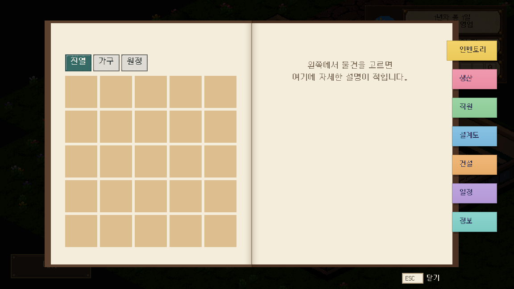
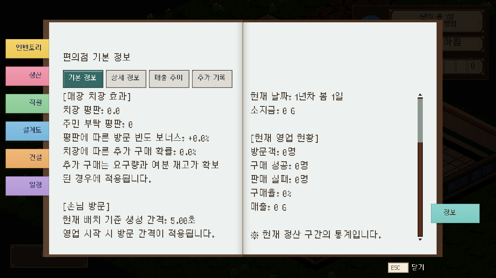

# UI 디자인 규칙

2026-10-12 · 사용자 지적에 따른 개선 범위와 제작 기준

## 1. 이번 정정

일반 버튼·입력란을 정리하는 요청을 수첩의 포스트잇까지 확대하면서 기존 종이 책갈피를 회색·청록 버튼처럼 바꿨다. 실행 오류가 없다는 검사만으로 사용자가 원한 디자인을 충족했다고 판단한 것이 문제였다.

수첩의 포스트잇은 `13cf1dca` 직전 상태를 기준으로 복원한다. 책·종이 배경, 구역별 포스트잇 색과 모양, 현재 쪽 가장자리를 감싸는 부분, 이전 쪽의 왼쪽 책갈피, 책장에 붙어서 넘어가는 질감과 여닫기/넘김 연출을 보존한다. 일반 창의 제목줄·이름 입력 대비 개선은 별도 범위로 유지한다.

## 2. 역할부터 구분한다

| 역할 | 기준 | 변경 범위 |
|---|---|---|
| 배경·프레임 | 숲 배경, 종이, 책 표지, HUD 틀 등 기존 분위기 유지 | 잘림·대비·배치 문제에 필요한 부분 |
| 수첩 포스트잇 | 종이 책갈피, 구역별 색, 책장과 함께 움직임 | 글자 잘림·겹침·클릭 영역 개선. 모양·구역색·연출은 별도 변경 요청 때만 |
| 일반 확인창 | 제목줄·본문·입력란·확인/취소 영역을 명확히 구분 | 창 구조·여백·대비 |
| 본문 버튼·소탭 | 배경과 구분되는 단순한 조작부, 같은 종류는 같은 크기/테두리 | 기본·마우스 올림·누름·선택·비활성 상태 |
| 입력란 | 밝은 바탕과 읽히는 글씨, 포커스 테두리 | 안내 문구·커서·선택 글씨·입력 검증 |

**클릭 기능이 있어도 기존 연출을 가진 요소는 그 연출을 유지한다.** 공통 버튼 스킨은 본문 조작부에 적용하며 수첩 포스트잇을 덮어쓰지 않는다.

## 3. 강조 상태의 규칙

| 상태 | 표현 |
|---|---|
| 기본 | 주변 배경에 어울리는 차분한 바탕·얇은 테두리·읽히는 글씨 |
| 마우스 올림 | 같은 모양에서 밝기나 테두리만 조금 변화 |
| 누름 | 같은 모양에서 눌린 깊이/명도 변화 |
| 선택 | 같은 선택 묶음에서 현재 항목 하나를 강조 |
| 비활성 | 대비를 낮추되 글씨는 읽히게 유지. 선택 상태와 구분 |
| 입력 포커스 | 입력란 테두리·커서 변화. 입력란 전체를 진한 선택색으로 채우지 않음 |

포스트잇의 여러 색은 기존 구역 식별색으로 유지한다. 현재 쪽은 기존 접힘/위치로 구분하고, 모든 책갈피에 공통 버튼의 누름/선택 그림을 씌우지 않는다. 본문 소탭의 현재 항목 표시와 책갈피 연출은 각각 처리한다.

## 4. 크기·글씨·그림 제작 기준

- Silver 원본과 공통 `Silver_ui.tres`를 유지한다. 크기는 `UiTypography`를 통해 정하며 같은 역할의 글씨에 서로 다른 임의 배율을 추가하지 않는다.
- 기존 확정 배치의 수첩 포스트잇은 100×44, 쪽을 감싸는 길이 12, 구역 간격 20을 유지한다. 그림 교체를 이유로 클릭 위치·좌우 이동·넘김 시간을 변경하지 않는다.
- 일반 조작부를 다음에 정돈할 때 기본 간격은 8px, 큰 구분 간격은 16px로 사용한다. 버튼·입력란 높이는 글씨를 포함해 최소 40px, 표준 44px를 기준으로 한다. 현재 모든 화면의 크기를 이 문서만으로 일괄 변경하지 않는다.
- 상태별 그림은 같은 캔버스·모서리·테두리 두께·9패치 여백을 공유한다. AI가 상태마다 만든 다른 실루엣을 그대로 연결하지 않는다.
- 글자는 그림에 굽지 않고 실제 폰트로 표시한다. 테두리는 9패치로 유지하고, 원본이 찌그러지도록 가로·세로 배율을 임의로 바꾸지 않는다.
- 기존 연결한 `art/ui/controls/` 12장은 현재 구현이다. 사용자에게 최종 디자인으로 확정받은 것으로 취급하지 않으며, 후속 조정은 위 규칙과 실제 비교 화면을 기준으로 한다.

## 5. 작업 순서

1. 화면과 부품을 이름으로 특정하고, 개선할 문제·유지할 표현을 먼저 기록한다.
2. 기존 기준 화면을 남긴다. 새 출력 전에 재사용할 배경과 연출을 확인한다.
3. 이름 입력창처럼 대표 화면 하나에서 같은 부품의 모든 상태를 맞춘다.
4. 변경 전후를 보여 주고 해당 개선 방향이 맞는지 확인한 뒤 같은 종류의 부품에 확대한다.
5. 실제 입력·선택·취소·닫기·좁은 화면·긴 문장을 확인한다. 코드 검사 통과와 디자인 확인은 각각 기록한다.

새 요청에 포함되지 않은 색상 체계·배경·연출·카메라·기능 흐름을 UI 개선 과정에서 함께 바꾸지 않는다. 이름 입력창, 수첩, 원정 HUD를 한 번에 새 디자인으로 통일하지 않는다.

## 6. 담당 코드

- `InteractionUiStyle`: 일반 본문 버튼·입력란·소탭의 상태.
- `BookViews`와 `ManagementPresentation`: 수첩 종이·포스트잇·좌우 위치·넘김 질감. 일반 버튼 스킨 적용 대상에서 제외.
- `UiTypography`: 공통 폰트와 글자 크기 변환.
- `pixel_ui_theme.tres`: 공통 기본 테마. 변경 시 전용 연출의 override가 유지되는지 확인.

기존 [조작 UI 제작 기록](그림_작업/받은그림/조작_UI/게임_연결.md)의 회색·청록 책갈피 화면은 교체 당시의 기록이며, 이 규칙과 복원 화면을 최신 기준으로 본다.

## 7. 포스트잇 복원 확인

Godot 4.7.1 격리 복사본에서 최종 가져오기 2회 ERROR/SCRIPT ERROR 없이 종료, 전체 로드 920개 실패 0을 확인했다. 실제 GPU 이름 입력·펼침·인벤토리→설계도→정보→인벤토리 복귀와 캡처 13항목 실패 0. 책장 연출이 끝난 화면을 직접 확인했다. 에셋 FAIL 0·기존 WARN 23, 문서 링크/목록 누락 0.

`BookViews`는 교체 직전 코드와 동일하며, `ManagementPresentation`은 본문 조작부 테마 연결 한 줄을 제외하고 직전 코드와 동일하다. 책갈피의 색·글씨·모양·넘김 질감 선택이 복원됐다. 새 디자인이 승인된 것으로 기록하지 않는다. Windows RC1은 재빌드하지 않았다.

