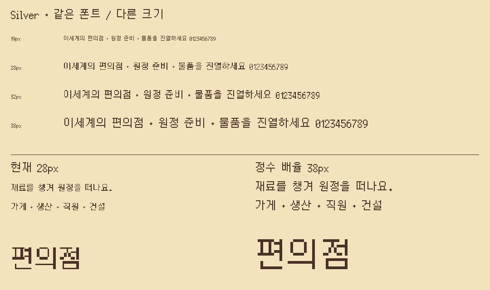
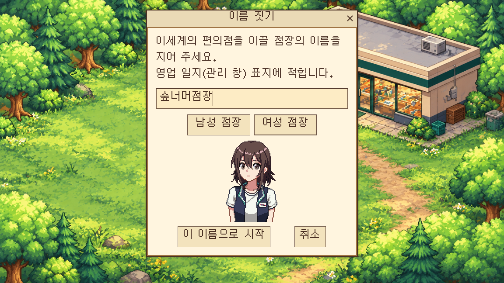
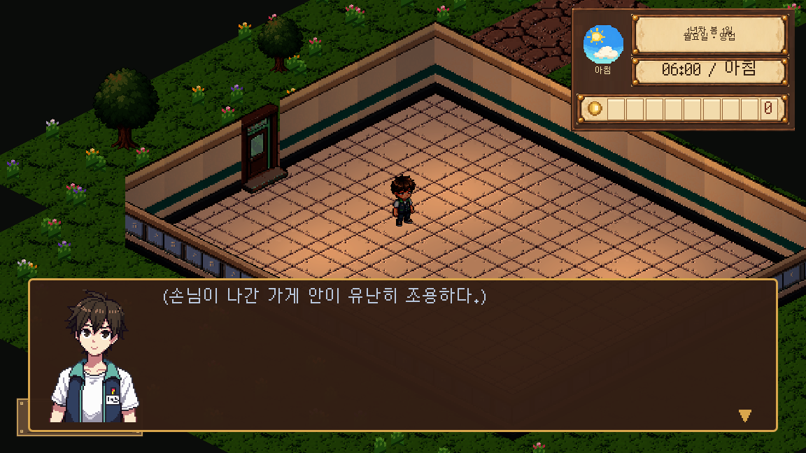
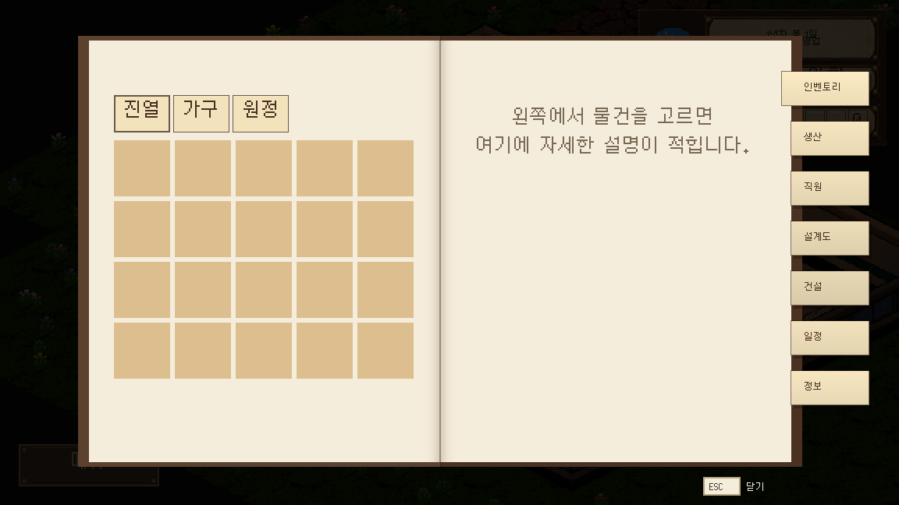
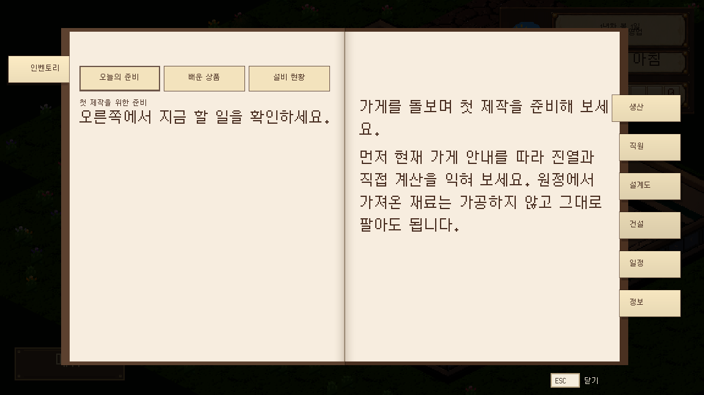
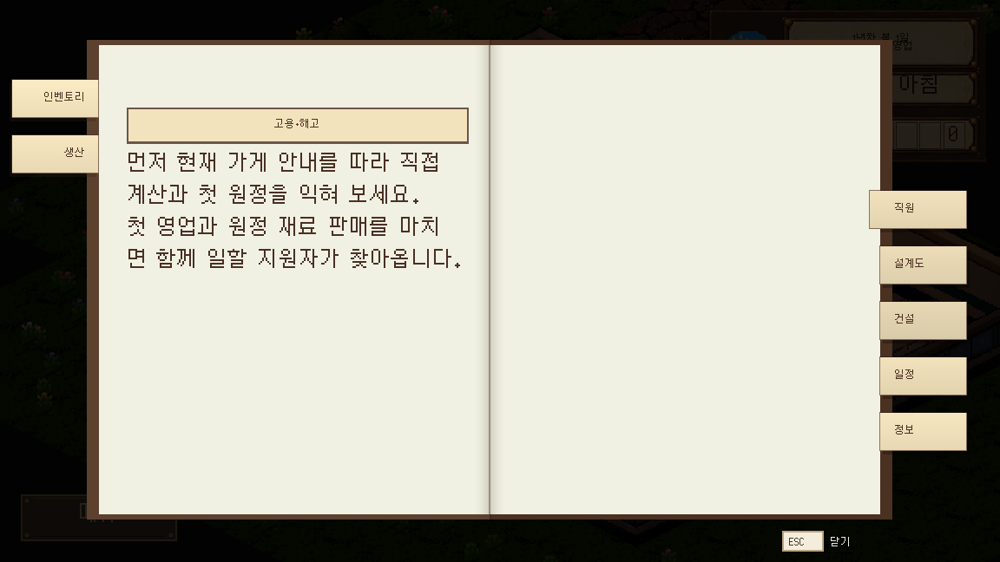
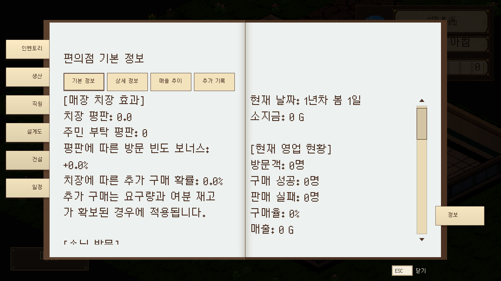
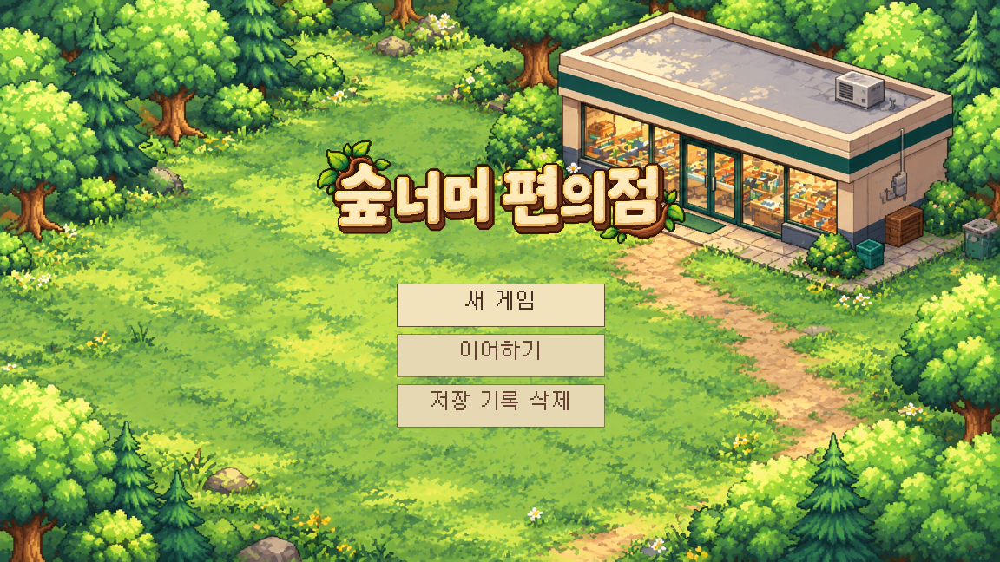
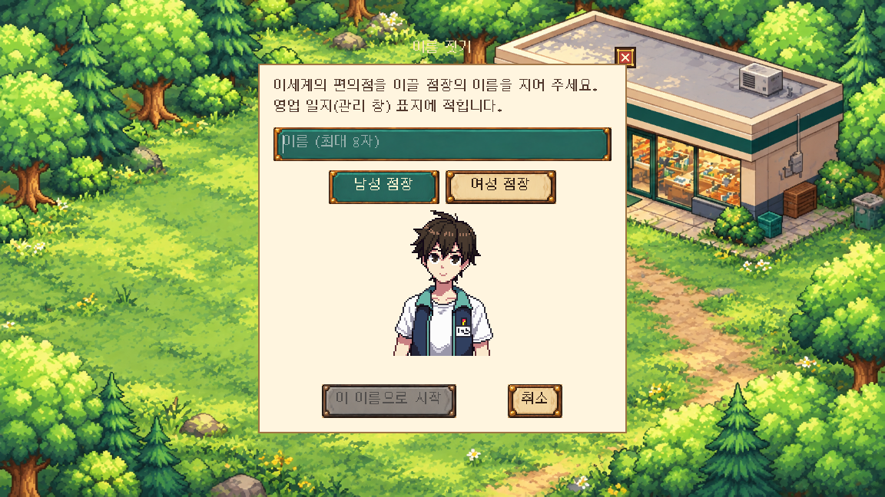
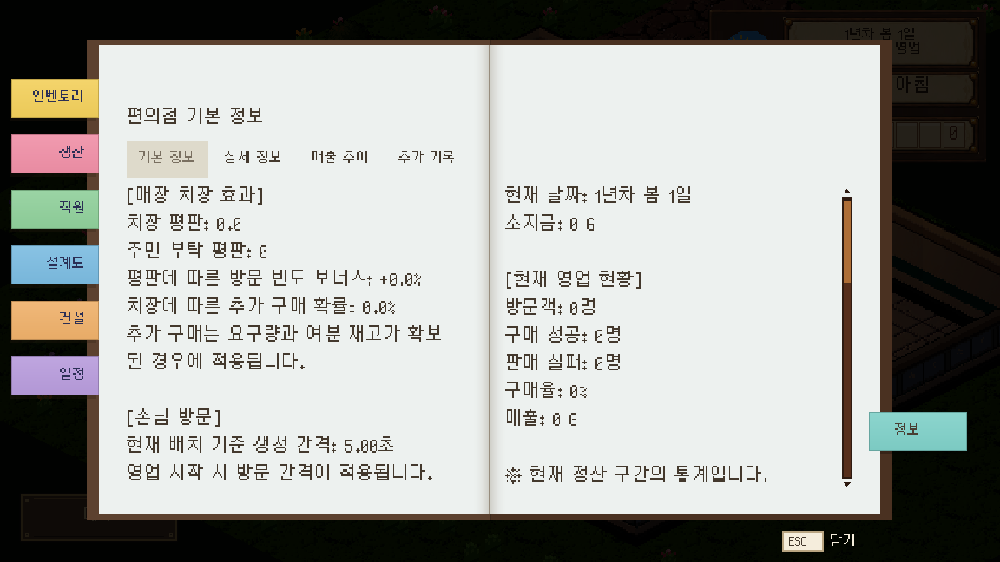

# Silver 폰트에 맞춘 UI 보강

2026-10-12 · 사용자 요청 반영 · main

## 최신 기준: 19px·38px 재출력 (2026-10-13)

사용자가 폰트가 깨져 보인다고 지적하여 실제 TTF의 글리프 좌표를 확인했다. unitsPerEm=1900, 도트 좌표의 공약수=100이므로 설계 크기는 19px다. 기존의 28·32px 등 임의 크기에서 획 두께가 불규칙해졌다. 아래의 최초 1.55배·짝수화 방식은 현재 기준이 아니며 이번 변경으로 대체한다. [Godot 공식 안내](https://docs.godotengine.org/en/stable/tutorials/ui/gui_using_fonts.html)도 픽셀 폰트에 설계 크기의 정수 배수와 정수 표시 배율을 요구한다.

사용자 요청 「해당 크기를 기준으로 재출력」에 따라 다음을 적용했다.

- `UiTypography`: DESIGN_SIZE=19, 보조 글씨 19, 기본 본문·버튼 38. 이전 18px 미만의 보조 역할은 19, 본문 역할은 최소 38, 큰 제목도 19의 정수 배수다.
- 공용 테마·창 제목 38px. 15개 장면의 직접 지정 크기도 19 또는 38로 맞췄다. 함수로 생성되는 HUD·대사·수첩 등의 크기는 공통 규칙을 따라 바뀐다.
- 원본 TTF SHA256·FontVariation 줄 여백·기존 올바른 가져오기 옵션은 유지했다. AA=0, subpixel_positioning=0(DISABLED), hinting=0, oversampling=1, MSDF/밉맵 OFF를 검사로 확인한다.
- 배경 그림·버튼 스킨·책갈피 종이 모양·클릭 위치·책장 넘김 코드·초상화 PNG는 수정하지 않았다. 폰트 크기 증가에 따라 기존 컨테이너의 자동 크기·줄바꿈이 작동한다.

### 새 실제 화면

아래는 Godot 4.7.1 GPU, 1152×648 출력이다. 이름 입력은 실제 키 이벤트로 입력하고 성별 버튼으로 여성 초상화를 선택했다. 대화·수첩 캡처는 도시 도입 연출만 `--no-cutscene`로 생략하고 기존 튜토리얼 첫 대사·초기 해금 상태를 사용했다. 새 게임부터 후반까지 모두 플레이한 기록은 아니다.

### 검증

- `check_silver_pixel_grid`: 121항목 실패0. GPU에서 한글·숫자·영문·기호 4문장의 38px 출력 전체가 19px 출력의 정확한 최근접 2배와 일치한다. 빈 출력이 아님과 원본 TTF SHA·가져오기 옵션·글리프 존재·공통 크기도 확인한다.
- 이름 입력·긴 대사·날짜·최대 12자리 금액: 1152×648와 800×600, 145항목 실패0.
- 실제 타이틀·이름 입력·첫 대화·수첩 7탭 출력: 18항목 실패0. 책장 애니메이션이 끝난 상태를 육안 확인했다.
- 공용 선택·체크·입력·팝업 GPU 32항목, 인벤토리 안내 53항목 실패0. 보상 50줄의 원정 결과창은 1152×648·593×523·800×450에서 스크롤·실제 확인 버튼 입력 실패0.
- 최종 가져오기 2회 ERROR/SCRIPT ERROR0. 격리 복사본의 전체 로드 923개 실패0(임시 출력 장면 포함), 문서 깨진 링크·목록 누락0. 기존 CSV의 Unicode/NUL 및 Door 충돌 노드 경고는 남아 있다.

푸시 직전에 받은 main `23dee6f5`의 CSV 분류·참조 갱신도 보존했다. 통합 복사본의 옛 데이터 경로 141개를 제거한 뒤 최종 가져오기 2회 ERROR0, 글리프121·UI145·실제 출력18·전체923 로드 실패0을 다시 확인했다.

기존 Windows RC1은 재빌드하지 않았다. 다른 PC의 DPI 설정이나 사용자가 게임 창 전체를 비정수 배율로 축소하는 환경에서는 별도 표시 확인이 필요하다.

## 바꾼 이유

Silver는 이전 폰트와 같은 크기 값을 사용하면 글자가 작게 보이고, 글자 위아래의 여백도 크다. 기존 18px 설정을 그대로 유지한 대화·수첩·날짜 표시에서 가독성이 떨어졌다.

원본 `art/fonts/Silver.ttf`는 그대로 유지했다(SHA256 `5bbbcd90b9f3ed71f8e15816fc114cbfefe9dfa29e5aacab31fe3f49fe1d1c89`). 이미지나 글리프를 다시 그리지 않고 폰트 크기와 줄 여백을 조정했다.

## 공통 기준과 적용

- `art/fonts/Silver_ui.tres`: 원본을 참조하는 FontVariation, 위 여백 -2·아래 여백 -6. 28px에서 원본 줄 높이 32px를 24px로 줄인다.
- `UiTypography`: 기본 28px. 기존 크기에 1.55를 곱하고 짝수로 반올림하며 최소 20px로 맞춘다. 기존 18 → 28, 21 → 32, 24 → 38.
- 공용 종이 테마와 코드로 만든 매장 테마에 같은 폰트를 연결했다. 장면·코드의 개별 글자 크기 130곳을 공통 기준으로 맞췄다. 직접 그리는 글자의 폭·높이 계산도 같은 크기를 사용한다.
- 타이틀 버튼은 이미 Silver 28px로 맞췄으므로 크기를 유지했다.
- 이름 입력창에 밝은 종이 배경·갈색 설명 글씨·줄바꿈·넓은 입력란과 선택 버튼을 적용했다.
- 날짜·시간·돈 표시의 글씨와 칸 높이를 맞췄다. 긴 시간 설명은 작은 글씨를 사용하며 시간대 설명은 줄바꿈한다.
- 대화창은 다음 표시의 세로 공간을 줄여 본문 줄 공간을 확보했다. 튜토리얼 제목에도 줄바꿈을 적용했다.
- 관리 수첩·인벤토리·생산·직원·설계도·게시판·낚시·원정 준비/결과 등에 같은 글자 기준을 적용했다.

그림 비율·피해 숫자 도트·카메라·게임 수치·해금 조건·저장 형식은 변경하지 않았다.

## 실제 실행 화면

격리된 새 게임에서 캡처한 원본 화면이다. 책 화면은 펼침·탭 전환 연출이 끝난 뒤 확인했다.

## 검증과 남은 범위

Godot 4.7.1, 사용자 저장과 분리한 `foodbag_checks` 환경에서 검사했다.

| 검사 | 결과 |
|---|---|
| 최종 가져오기 두 번 | 종료 0, SCRIPT ERROR/ERROR 없음 |
| 새 `check_silver_ui_typography` | 139항목·실패 0: 원본 폰트 해시, 입력창, 긴 대사, 두 해상도, 최대 12자리 돈 표시·영역 확인 |
| 실제 GPU 새 게임·HUD·수첩 7탭 | 14항목·실패 0, 실행 화면 직접 확인 |
| 격리 복사본 전체 로드 | 921개·실패 0(임시 검사 장면 포함) |
| 인벤토리 품목 안내 | 53항목·실패 0 |
| 메뉴 열 때 안내 숨김 | 2항목·실패 0 |
| 원정 결과 | 보상 50줄, 1152×648·593×523·800×450에서 스크롤과 실제 마우스 확인 버튼 통과 |
| 에셋·문서 검사 | 에셋 FAIL 0·기존 WARN 23, 깨진 링크·목록 누락 0 |

Unicode/NUL 번역 및 Door 충돌 노드 경고는 기존 경고다. 수첩 화면 점검은 초기 해금 상태를 기준으로 했으며 모든 후반 콘텐츠를 손으로 진행한 검증은 아니다. 창 전체가 축소되는 작은 화면에서는 글씨도 함께 작아진다. 후속 UI 구성 변경 때도 긴 문장·버튼·스크롤을 확인해야 한다.

기존 Windows RC1 ZIP은 재빌드하지 않았다. 다음 Windows 빌드에서 이 변경을 포함한다.

푸시 전 최신 main(`019e9194`)의 대사·화자 전환 수정과 사용자 승인 미사용 코드 정리를 받았다. 충돌 없이 병합된 복사본에서도 가져오기 두 번 오류 0·전체 로드 919개 실패 0·UI 검사 139항목 실패 0을 확인했다. 삭제된 미사용 장면·스크립트 때문에 로드 대상 수는 앞 검사보다 줄었다.

사용자 후속 화면 지적으로 장식 버튼과 떠 있는 제목 문제를 추가 보정했다. 최신 화면과 변경 범위는 [일반 창과 조작 UI 연결](받은그림/조작_UI/게임_연결.md)을 기준으로 본다.
