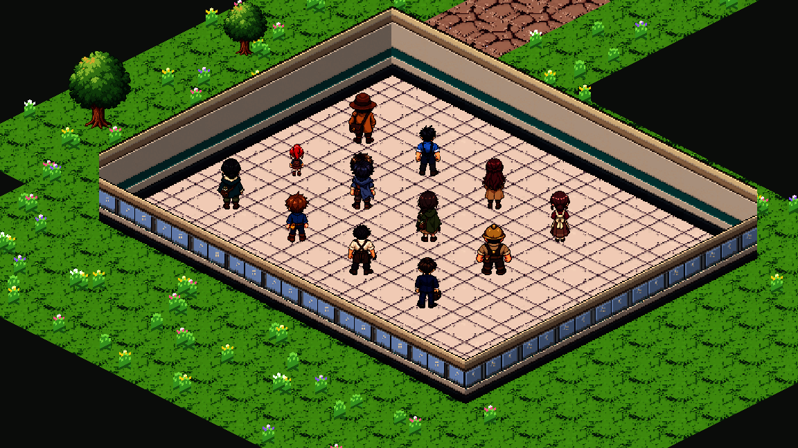

# 원본을 기준으로 보강한 NPC 방향

2026-10-12 · `main` · 개인 NPC 10명과 대장장이·현대 직장인의 정지 방향 연결.

## 원본과 적용 범위

사용자가 생성 원본 `개인_NPC_등각/생성_원본/naru.png`를 기준으로 하도록 정정했다. 최초 축소 그림 참조 시트는 얼굴·모자·가방 디자인이 달라 적용하지 않았으며 `생성_원본/naru_scaled_reference_rejected.png`에 보존했다.

개인 NPC는 기존 생성 원본 10장, 대장장이·현대 직장인은 기존 체형 참고 원본 2장을 내장 **image_gen**의 참조로 사용했다. 새 방향에서 보이는 면은 생성된 후보이며 기존 그림의 픽셀이 그대로 회전한 결과라고 주장하지 않는다. 원본의 복장·대표 소품·색을 대조하고 게임 크기와 3배 비교표, 실제 렌더의 8방향을 확인했다.

- **현재 선택 중인 남서 방향 PNG 12장과 생성 원본 12장은 수정하지 않았다.** 기존 초상화·표정·플레이어·공용 손님·직원 그림도 유지했다.
- 12명 × 8방향 = 96프레임. 추가 PNG는 84장이다. 남동 12장은 기존 남서를 좌우 반전한 픽셀이며 다른 72장은 원본 기반 방향 시트에서 분리했다. 그중 피니아·엘미·바르크의 동쪽과 바르크의 북서쪽은 방향 보정을 위해 시트의 좌우 반전을 사용했다. 별도의 84회 생성이나 84개의 서로 다른 원화로 세지 않는다.
- 반전한 방향은 비대칭 소품의 좌우도 반전된다. 소품의 해부학적 좌우까지 고정하는 독립 방향 원화가 필요한 경우 해당 방향만 후속 보정한다. 현재 프레임의 출처·반전 여부는 매니페스트에 명시했다.
- 모든 방향은 96×96 투명 캔버스, 기존 인물별 높이, 기존 팔레트 96색 이하, 발 (48,90)을 사용한다. 전체에 같은 배율의 최근접 축소만 적용했다. 축별 몸 압축은 없다. 축소에서 외곽 한 줄이 빠지는 경우 실제 발 끝을 다시 지면에 맞추며 표시 높이는 기존 기준을 공유한다.
- AI 시트가 칸 중심을 정확히 지키지 않는 경우가 있어, 고정 사각형으로 자르지 않고 실제 불투명 연결 영역의 전체 경계로 분리했다. 기존 남서 그림에는 이 처리를 적용하지 않았다.
- 방향별 노멀맵과 기존 조명을 사용한다. 좌식, 대화·도구 거래·손님 역할·저장·보상 규칙을 바꾸지 않았다.

## 게임 연결

`data/art/npc_direction_assets.json` → `NpcDirectionArt` → `NpcSpriteArt`/서 있는 `ActorPoseArt` → `PixelActorFigure` 순으로 읽는다. 이동 방향을 화면에 투영해 준비된 정지 그림을 선택한다. 방향별 그림이 누락되면 기존 한 방향을 사용한다.

새 NPC 묶음의 걷기 배열은 빈 상태다. `PixelActorFigure`는 걷기 프레임이 실제 있는 인물만 걷기 애니메이션을 재생한다. 추가 NPC는 이동 중에도 정지 그림의 방향만 바뀐다. 기존 공용 손님·직원·플레이어의 걷기 프레임은 유지한다.

## 결과와 원본 기록

- [제작 입력·최종 프롬프트](제작_입력.json): 참조 원본, 내장 도구의 실제 저장 경로, 각 시트의 실제 방향 칸 분류, 최초 보류 이유.
- [검사 결과](검사_결과.json): 생성 원본·기존 선택 PNG·참조 원본 SHA256.
- [비교표 1](방향_비교_1.png), [비교표 2](방향_비교_2.png), [비교표 3](방향_비교_3.png).
- 생성 원본은 `생성_원본/`, 추가 게임 PNG는 `art/actors/directions/`에 저장했다. 기존 기본 PNG 경로는 유지했다.
- 재현 도구 `tools/install_npc_direction_art.py`는 기본 읽기 전용이다. `--install`은 새 방향과 목록을 기록하고 기존 남서·참조 원본은 쓰지 않는다.

## 실제 게임 렌더

검사용 12명을 같은 매장에 배치하고 UI를 숨긴 화면이다. 실제 주민의 평소 위치를 재배치한 것이 아니다.

[앞](실행_화면/south.png) · [오른쪽](실행_화면/east.png) · [왼쪽](실행_화면/west.png) · [남동](실행_화면/south-east.png) · [북동](실행_화면/north-east.png) · [북서](실행_화면/north-west.png) · [기존 남서](실행_화면/south-west.png) · [낮](실행_화면/day.png) · [밤](실행_화면/night.png).

## 검증

Godot 4.7.1, 실제 사용자 저장과 분리한 프로젝트와 APPDATA에서 확인했다.

| 검사 | 결과 |
|---|---|
| 원본 SHA·12명×8방향·360도/카메라·빈 걷기 배열·선택 PNG·발·색/마스크·법선·GPU 낮밤 | 3,121개, 실패 0 |
| 기존 개인 NPC 역할·등장·조명 | 165개, 실패 0 |
| 기존 상태·의상·벤치 좌식·중단 복원 | 13,194개, 실패 0 |
| 공용 손님·직원·플레이어 걷기·방향·렌더 | 1,809개, 실패 0 |
| 프롤로그 진행/저장/건너뛰기 | 37개, 실패 0 |
| 전체 코드·장면 로드 | 899개, 실패 0 |
| 그림 경로 감사 | 1,723개, 실패 0 |
| 에셋 규격 검사 | PASS 1,967 · 기존 WARN 28 · FAIL 0 |
| 픽셀 재현·추가 가져오기 UID | 12명·96프레임 재현 통과, 새 PNG UID 84개 모두 고유 |

최초 샌드박스 실행에서 Windows 루트 인증서 읽기 오류가 있었다. 동일 격리 프로젝트를 제한 밖에서 가져오기 2회 및 방향·공용 인물·프롤로그·전체 로드로 확인했으며 SCRIPT ERROR/ERROR는 0이다. 기존 Unicode NUL 경고와 프롤로그 검사 중 Door 충돌 노드 경고는 유지한다.

새 검사 장면은 `res://dev/scenes/check_npc_direction_art.tscn`이다. 현재 사용 폴더에서 `main`을 Pull하고 게임을 다시 실행한다. 남은 정적 인물 보강은 실제 사용할 주민의 좌식이며, 새 걷기·전투·낚시 애니메이션은 기존 결정대로 보류한다.
