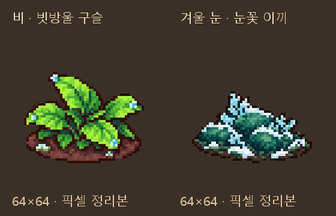

# 날씨 전용 채집물 그림 후보

2026-10-11 · main · 사용자 요청: 다음에 필요한 그림 출력

## 이번 출력

앞서 만든 계절 채집물4종에 이어, 실제 채집 테이블이 있지만 전용 그림이 없는 날씨 채집물2종을 만들었다.
Codex 내장 **image_gen**을 각각 호출했다. 기존 덤불 및 계절 그림은 도트·색감·등각 방향 참조다.
원본2장과 사용자가 허용한 Python 픽셀 정리본2장을 같은 폴더에 저장했다.

| 그림 | 조건 | 실제 테이블 | 후보 |
|---|---|---|---|
| 빗방울 구슬 | 비 오는 날 · 계절 제한 없음 | climate_rain_pearl | [64×64 그림](픽셀_정리/rain_pearl.png) |
| 눈꽃 이끼 | 겨울 · 눈 오는 날 | climate_snow_bloom | [64×64 그림](픽셀_정리/snow_bloom.png) |

물방울 맺힌 넓은 잎은 물박하와 구분하고, 낮은 이끼·푸른 잎·얇은 눈은 서리 얼음의 바위 덩어리와 구분했다.
새 수치·재료·해금 조건은 만들지 않았으며 기존 CSV 조건을 기록했다.

## 규격과 확인

- 두 장 모두64×64 RGBA, 남서쪽 단일 등각 시점, 발밑 기준점(32,56).
- 알파128 이상 경계 크롭 후 비율 유지·최근접 축소. 빗방울50×38, 눈꽃50×30.
- RGB32색 이하·알파0/255·투명RGB0·SHA256·실제 재료/채집 테이블 및 계절/날씨 조건 일치.
- 최초 빗방울32색 전체 양자화에서는 작은 물방울 색이 사라졌다.
  바탕24색/물방울 강조8색을 따로 뽑아 공통32색 팔레트로 다시 정리했고, 청색 물방울29픽셀이 유지되는지 확인했다.
- 기존 계절4종 원본/정리본 바이트 유지. 전체 후보6장 해시 통과.
  실행147+332장 해시와 런타임 매핑 내용도 그대로다.
- 에셋 검증 FAIL0/WARN28/아이콘 누락0. docs 후보는 별도 픽셀·해시 검사로 확인한다.
  문서 검사: 깨진 링크0·목록 누락0.
- [생성 프롬프트와 참조](날씨_프롬프트.json), [픽셀/규격 검사](날씨_검사_결과.json),
  [전체 후보 목록](후보_목록.json), [계절·날씨6종 비교](계절_날씨_전체.png).

## 현재 상태와 이어갈 일

**계절4종과 날씨2종은 후보이며 아직 게임에 연결하지 않았다.**
이번 작업은 그림 출력·저장만 검증했다. 런타임 조명·보행·진행 검사를 새로 실행하지 않았다.
별도 회전·노멀맵은 이번 출력에 포함하지 않았다.

다음 연결은 실제 `gathering_sites.table`과 환경조건에 대응하여 이6종을 선택하는 작업이다.
현재 원정 무대는 `object_consumed`가 참이면 채집 오브젝트를 숨기므로, 이 소진 처리를 따를 수 있다.
별도 수확 후 그림을 연결하려면 실제 상태 규칙부터 확인한다. 일반 마을 열매덤불의 수확 전후와는 구분한다.
