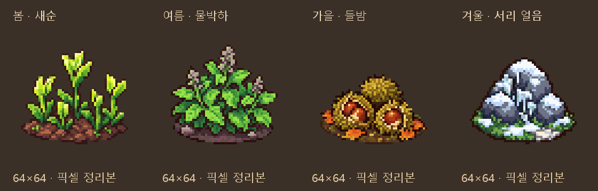

# 계절 전용 채집물 그림 후보

2026-10-11 · main · 사용자 「다음꺼 출력」 요청

## 출력한 그림

냉장·냉동 네 방향 연결 다음 순서인 계절 전용 자연물 4종을 출력했다.
Codex 내장 **image_gen**을 각 그림별로 호출했고, 사용자가 허용한 Python 픽셀 보정을 이어 사용했다.
기존 `art/received/nature/bush.png`, `flower_bush.png`, `rocks.png`는 스타일 참조다.
원본 자연물의 픽셀을 그대로 복사한 그림은 아니며 같은 크기의 새 후보다.

| 계절 | 재료 | 채집 테이블 | 게임용 후보 |
|---|---|---|---|
| 봄 | 봄 새순 | climate_spring_bud | [새순](픽셀_정리/spring_bud.png) |
| 여름 | 여름 물박하 | climate_summer_mint | [물박하](픽셀_정리/summer_mint.png) |
| 가을 | 가을 들밤 | climate_autumn_nut | [들밤](픽셀_정리/autumn_nut.png) |
| 겨울 | 서리 얼음 | climate_winter_frost | [서리 얼음](픽셀_정리/winter_frost.png) |

## 규격과 검사

- 단일 남서쪽 등각 시점, 64×64 RGBA, 발밑 기준점 (32,56).
- 생성 원본 알파128 이상인 영역을 크롭하고 비율을 유지하여 최근접 축소했다.
  새순50×45, 물박하50×47, 들밤50×33, 서리 얼음50×41이며 모두 바닥끝 y=56이다.
- 불투명 RGB32색 이하, 알파0/255, 투명 픽셀 RGB0. 네 장 모두 검사 통과.
- 원본 PNG4장, 정리본4장, 비교 시트1장, [생성 프롬프트](프롬프트.json),
  [크롭·크기·팔레트·해시 검사](검사_결과.json), [후보 대응 목록](후보_목록.json)을 보존했다.
- 문서 검사: 깨진 링크0·목록 누락0. 기존 에셋 검사 FAIL0/WARN28/아이콘 누락0이며, 새 docs 후보4장은 별도 픽셀·해시·실제 재료/채집 테이블 대응 검사로 확인했다. 기존 런타임332장 해시도 모두 일치했다.
- 후보 상태만 검사했다. 게임 조명·보행·수확 동작은 이번 작업의 검증 범위가 아니다.

## 연결 상태와 다음 작업

**이번 출력은 후보 저장이며 게임에는 아직 연결하지 않았다.**
원정의 재료·계절·날씨·도구·드롭 수치와 기존 그림은 변경하지 않았다.
실행 매핑 `pixel_shop_assets.json`의332장에도 후보를 추가하지 않았다.

다음 연결 시 실제 `gathering_sites`의 table에 따라 선택하고, 채집 소진 시에는
기존 모델의 실제 진행 상태에 따라 표시를 제거하거나 수확 후 그림을 선택해야 한다.
그림만 교체하고 채집 여부를 별도로 추측하지 않는다. 이번 묶음에는 수확 후 그림,
다른 회전과 전용 노멀맵은 포함하지 않았다. 1차에 없던 빗방울 구슬·눈꽃 이끼는 다음2차 출력에서 보강했다([날씨 제작 기록](날씨_제작_기록.md)).
일반 자연물의 사계절 변형과 이번 계절 전용 채집 지점은 별개다.

## 날씨 채집물 추가 (2차 출력)

빗방울 구슬·눈꽃 이끼를 추가하여 후보는 총6종이다.
[날씨 제작 기록](날씨_제작_기록.md)과 [전체 비교](계절_날씨_전체.png)에서 확인한다.
1차4종 원본과 픽셀 정리본은 그대로 보존했다. 게임 연결은6종 모두 후속 작업이다.
