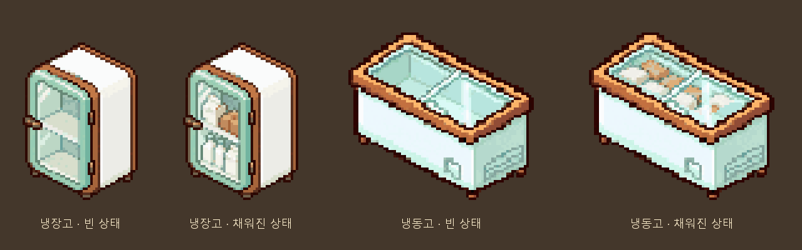
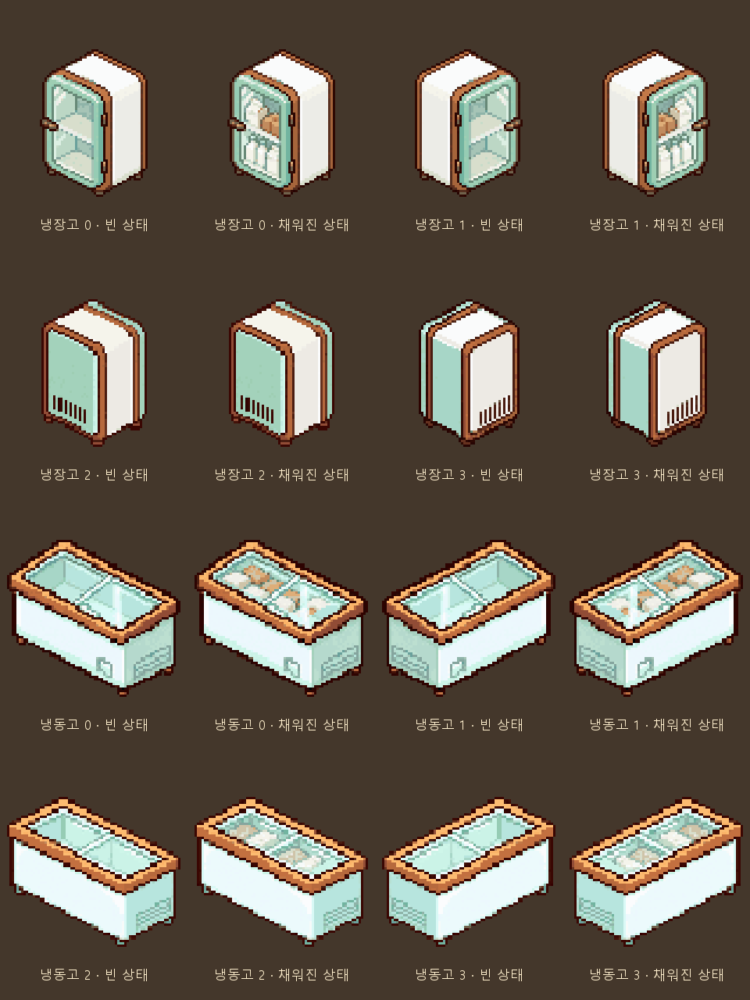

# 냉장고·냉동고 상태 그림 후보

작성: 2026-10-11 · main · 사용자 요청으로 Codex 출력

## 출력 범위

가구 전체 빈/채워진 그림 두 상태만 사용한다. 실제 물품 ID·수량·진열칸과 대응하지 않는다.
기존 그림을 참조해 내장 image_gen으로 **앞방향(rotation_0) 후보 4장**을 만들었다.
일반 이미지 생성 담당 규칙을 바꾸는 것은 아니며, 이번 요청 범위에서 Codex가 출력했다.

| 가구 | 빈 상태 | 채워진 상태 | 캔버스 / 기준점 |
|---|---|---|---|
| 냉장고 | [빈 그림](픽셀_정리/fridge_empty_rotation_0.png) | [채움 그림](픽셀_정리/fridge_filled_rotation_0.png) | 64×128 / (32,104) |
| 냉동고 | [빈 그림](픽셀_정리/freezer_empty_rotation_0.png) | [채움 그림](픽셀_정리/freezer_filled_rotation_0.png) | 128×128 / (64,104) |

## 그림과 픽셀 정리

- 민트색 문틀·크림색 몸체·갈색 윤곽을 기준으로 만들었다. 냉장고는 유리문으로 내용물을 보이게 한 후보다.
  원본의 몸체 픽셀 자체를 그대로 옮긴 그림은 아니며, 유리문·내부를 포함해 다시 그린 후보다.
- 채워진 상태는 일반 종이 포장·병·식품 꾸러미의 고정 모습이다. 상품을 추가할 때 그림을 다시 만들지 않는다.
- 앞서 사용자가 허용한 Python 게임용 픽셀 보정 흐름을 사용했다.
  생성 알파128 이상 경계를 기준으로 크롭, 원본 몸체 범위 안에 비율을 유지해 최근접 축소,
  기존 몸체 밑변에 정렬했다. 이진 알파와 공통64색 팔레트를 사용했다.
- 냉장고 생성 크롭(112,750,764,1649) → 46×63, 배치(9,53).
  냉동고 생성 크롭(269,578,983,1223) → 74×67, 배치(26,56).
- 빈 후보를 두 상태의 공통 몸체로 고정하고, 채움 후보의 유리 안쪽만 합성했다.
  냉장고470픽셀/냉동고529픽셀 차이, 내부 영역 밖 차이0·알파 차이0.
- 개별 스프라이트에는 아이콘·문자·보관량 표시가 없다. 비교 시트에만 설명을 썼다.
- 기존 실행용 냉장/냉동 회전0~3 원본8장은 변경하지 않았다.

## 현재 적용 상태

**사용자가 회전 방향 완성과 게임 적용을 승인하여 네 방향·두 상태16장을 연결했다.**
앞방향 후보4장은 그대로 사용했고, 나머지 방향은 아래 후속 절과 같다.
`ContainerStockArt.cold_pair()`가 네 방향의 전용 empty/filled 그림을 선택한다.
설계도 미리보기에서도 새 빈 그림을 사용한다. 같은 종류 설비가 보관함을 공유하는 기존 규칙은 유지했다.

이전 인수인계의 냉동고64×128/(32,104) 표기는 잘못이었다.
실제 기존 냉동고는128×128/(64,104)이며 이번 후보와 연결 규격에서 바로잡았다.

## 기록

- [생성 프롬프트](프롬프트.json): 내장 image_gen 호출에 사용한 네 프롬프트.
- [후보 파일·원본 해시](후보_목록.json): 생성 원본·픽셀 정리·비교 시트.
- [두 상태 픽셀 검사](검사_결과.json): 크기·기준점·내부 변화·외부/알파 불변.
- 최초 후보 출력은 그림과 문서만 추가했다. 후속 적용에서는 설계도 미리보기와 검사를 수정했고,
  경제·저장·조명 규칙은 바꾸지 않았다.

## 최초 후보 검증 결과

- 후보PNG9개 크기/해시 확인, 두 상태 내부 외 픽셀 차이0·알파 차이0.
- 기존 실행 원본8개가 HEAD와 동일한 해시임을 확인했다.
- 에셋 검사 FAIL0/WARN28/누락 아이콘0. 이 검사는 주로 실행 art 폴더 대상이며,
  새 docs 후보는 위의 파일·픽셀 검사로 별도 확인했다.
- 문서 링크/목록 오류0, diff 검사 통과. 런타임 변경이 없어 게임 실행 검사는 이번에 반복하지 않았다.

## 네 방향 완성·게임 적용 (2026-10-11)

사용자 요청: **회전방향까지 그린 다음 게임에 적용**.
이번 생성도 내장 image_gen을 사용하고, 앞서 허용한 Python 픽셀 정리로 마무리했다.

| 가구 | 회전0 | 회전1 | 회전2 | 회전3 |
|---|---|---|---|---|
| 냉장고 | 기존 앞방향 후보 | 앞방향0의 픽셀 반전 | 기존 뒤면2 참조 생성 | 기존 뒤면3 참조 생성 |
| 냉동고 | 기존 앞방향 후보 | 앞방향0의 픽셀 반전 | 기존 뒤면2 참조 생성·두 상태 | 뒤면2의 픽셀 반전 |

- 냉장고 뒤면2/3은 불투명 몸체라 내용물이 보이지 않으며, 빈/채움 파일이 동일한 모습이다.
  냉장고 앞면0/1과 냉동고 네 방향은 유리 안쪽만 달라진다. 아이콘이나 개별 물품 합성은 없다.
- 새 생성 원본4장을 기존 원본4장과 함께 보존했다. [회전 생성 프롬프트](회전_프롬프트.json).
- [회전 정리 좌표](회전_정리.json): 알파128 이상 크롭, 기존 몸체 범위에 비율을 유지해 최근접 축소,
  원본과 같은 캔버스/기준점·공통 앞면 팔레트에 맞췄다. 기존 앞방향 픽셀4장은 변경하지 않았다.
- [회전 픽셀 검사](회전_검사.json): 냉장0/1은470픽셀, 냉동0/1은529픽셀,
  냉동2/3은512픽셀만 변화한다. 모든 방향의 상태 간 내부 외 픽셀/알파 차이는0이다.
- 실행 경로: `art/received/furniture/fridge_unit/empty_rotation_0.png`·`filled_rotation_0.png`,
  냉동고는 `freezer_unit`, 각 회전0~3. 런타임 PNG16장과 가져오기 설정16개를 추가했다.
- `data/art/pixel_shop_assets.json`에16장 원본 경로/크기/해시를 추가했다(316→332).
  기존316장과 원래 닫힌 냉장·냉동8장은 유지했다.
- 설계도 `ReceivedFurniturePreview`는 공통 냉장·냉동 경로의 빈 상태를 사용한다.
  건축 미리보기도 이미 공통 판정에서 빈 상태를 사용한다.

### 실행 확인

- 실제 main에서 냉장·냉동 네 방향을 배치한 화면을 빈 상태와 입고 뒤 상태로 각각 확인했다.
  사용자 저장과 분리한 foodbag_checks 프로젝트, 설비 설치/재고는 검사용 준비값이며,
  조명은 forced_hour=12로 고정했다(기존 HUD 시계는6시). 시험 배치는 실제 플레이 진행 기록이 아니다.
- 실제 보관 서비스 입고→수량 추가→다른 물품 입고→모두 출고, 네 방향 전용 그림/같은 크기·노멀맵,
  상품 종류/수량 변경 시 같은 메시, 표시 중 보관값 불변·건축 미리보기·설계도 연결을 확인했다.
- GPU1,954개 실패0·SCRIPT ERROR0. import2회 오류0·전체859개 GD/씬 로드 실패0,
  기존 NUL 진단4건 동일. 332 PNG의 크기/해시, 실행16장의 픽셀 정리본과 원본 복사 일치,
  기존 닫힌 원본8개 불변을 확인했다.
- 에셋 FAIL0/WARN28/누락 아이콘0, 경제 기준선 실행 완료(경제 CSV 변화 없음).
- 새 게임 전체 연속 플레이는 이번 그림 적용에서 다시 검사하지 않았다.

- 기존 그림759개/보존 서비스66개 검사도 실패0·SCRIPT ERROR0.
  기존 그림 검사의 냉장·냉동 경로8개가 닫힌 원본 기준이라 첫 실행에서 실패했으며,
  새 빈 그림 경로를 기준으로 갱신한 뒤759개 모두 통과했다. 기존 원본 보존 해시 검사는 유지했다.
