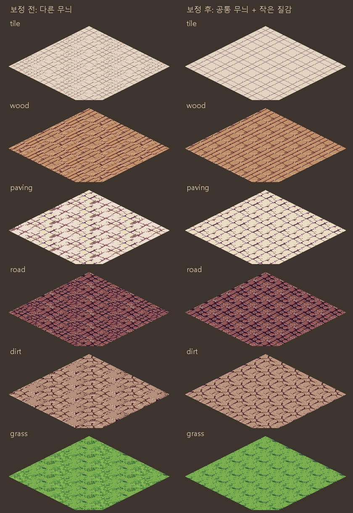
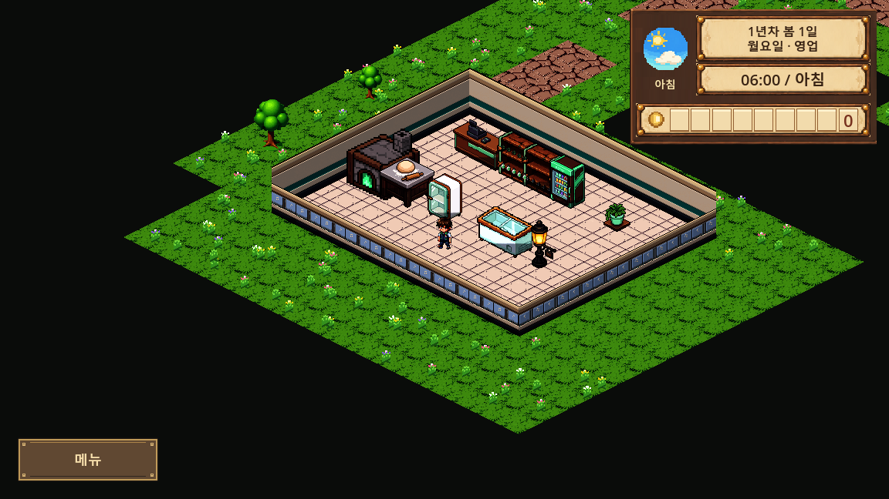

# 바닥 변형 타일의 공통 무늬 보정

2026-10-11 · main · 사용자 요청: 조금만 달라져야 할 바닥이 서로 다른 그림처럼 섞여 어색한 현상 수정.

## 원인과 수정

각 재질의 1·2·3번 그림이 단순 질감 변형이 아니라 줄눈·판재·돌·균열 위치와 크기까지 달랐다.
기존 셰이더는 칸 좌표로 이 세 장을 혼합하므로 다른 무늬의 경계가 반복됐다.
이전 해시/가져오기 검사는 파일 연결만 확인했고 변형끼리 무늬가 이어지는지를 확인하지 않았다.

- `tile`, `wood`, `paving`, `road`, `dirt`: 기존1번 그림을 공통 구조로 삼았다.
- `grass`: 기존2번의 낮은 밀도 잔디를 공통 구조로 삼아 중앙 풀 덩어리 반복을 줄였다.
- 변형2·3은 공통 그림 안쪽의 평탄한 면에 작은3×2픽셀 질감만 더했다.
  변경 RGB는 채널별 ±3 이하, 알파와 가장자리 픽셀은 공통 그림과 동일하다.
  줄눈·판재 외곽·균열·풀 강조점의 색상 경계는 바꾸지 않는다.
- 64×32 크기·등각 방향·재질 색감·월드 좌표 선택 규칙과 전체 밝기를 유지했다.
  재질 사이의 풀/길/흙 경계 자체를 새로 블렌딩하는 작업은 포함하지 않는다.
- 기존 받은 원본18장은 보존하고 [보정본18장](픽셀_정리/)을 별도 저장했다.
  실행 PNG는13장 변경·공통 템플릿5장은 이전 파일 바이트 그대로다.
  `received_assets.json`의 바닥18개 source/sha만 갱신했다(전체147개 유지).
  나머지129개 항목과 `pixel_shop_assets.json`의332개 항목은 그대로다.



이 비교는 기존 셰이더와 같은 칸별 변형 선택으로 6×6장을 CPU 배치한 것이다.
원래와 동일한 알파·배치를 사용했다. 아래 화면은 실제 Godot GPU 렌더러다.



## 재현과 확인

[보정 도구](../../../../tools/normalize_floor_variants.py):

```text
python -X utf8 tools/normalize_floor_variants.py --write
python -X utf8 tools/normalize_floor_variants.py --check
```

`--write`는 보존한 원본에서 보정본과 실행 그림·바닥 해시 항목을 재현한다.
`--check`는 파일·픽셀·변형 대비·실루엣·공통 가장자리·팔레트·해시 대응을 읽기만 검사한다.
[검사 기록](검사_결과.json)에 그림별 변경 픽셀수/대비/색수/원본 기준/실행 해시를 기록했다.

- 보정 도구18장 검사 통과. 변형마다 공통 불투명1024픽셀 중18% 이하만 변경.
- 받은 원본18장 HEAD 바이트 유지, 다른129개 received항목 그대로, 실행147+332장 SHA 모두 통과.
- 실제 가져온 이미지의 공통 가장자리/알파/작은 색차와 바닥 노멀맵 연결 검사를 추가했다.
  GPU `CHECK_RECEIVED_ART`: **877개 / 실패0**. 실제 6재질 바닥·낮/밤·카메라 이동 화면 저장.
- Godot4.7.1 source/격리 프로젝트 import 연속2회: 수정 후 오류0.
  전체GD/씬859개 로드 실패0·SCRIPT ERROR0.
- 에셋 검증 FAIL0/WARN28/아이콘 누락0, 경제 기준선 종료0(경제CSV/기준선 파일 변경 없음).
- 최초 새 검사에는 Texture2D(Vector2)와 Image(Vector2i) 크기 비교 타입 오류가 있었다.
  Vector2로 명시 변환하여 수정한 뒤 import/전체 로드/GPU 검사를 다시 통과했다.
- 기존 NUL문자4건/오두막 요청 규격 경고는 별도 기존 사항이다.

게임 캡처는 사용자 저장과 분리한 `foodbag_checks` 프로젝트에서 가구를 시험 배치한 화면이다.
낮빛을12시로 고정했고 HUD시간6시는 준비값이다. 전체 프롤로그·새게임 연속 진행을 다시 실행한 것은 아니다.
노멀맵은 기존 밝기 기울기 기반 생성/캐시를 유지하며 전용 새 형상 맵은 제작하지 않았다.
