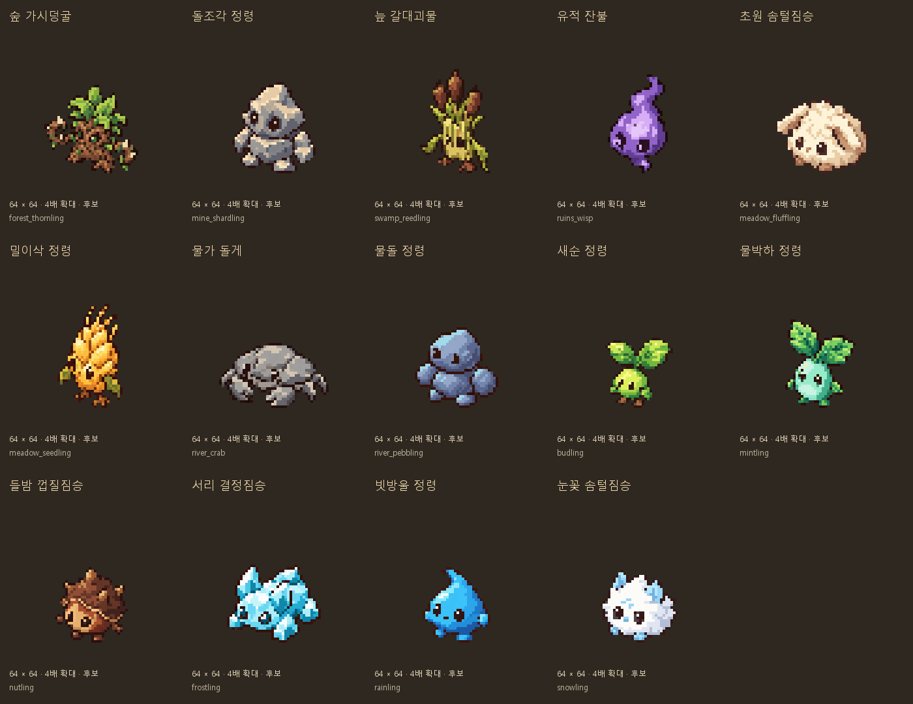

# 일반 몬스터14종 추가 출력 (2026-10-11)

사용자 일반 몬스터 출력 요청으로 남은 일반14종 전체를 Codex 내장 `image_gen`에서 개별 생성하고, 이전에 허용된 Python 픽셀 정리로 다듬었다. 애니메이션은 나중에 넣는 사용자 결정을 유지한다. **이번은 정적 기본 자세 후보 저장이며 게임에 적용하지 않았다.**

## 그림 구성

지역 일반8종: 숲 가시덩굴·돌조각 정령·늪 갈대괴물·유적 잔불·초원 솜털짐승·밀이삭 정령·물가 돌게·물돌 정령.

계절·날씨 일반6종: 새순 정령·물박하 정령·들밤 껍질짐승·서리 결정짐승·빗방울 정령·눈꽃 솜털짐승.

| ID | 실측 윤곽 | 색 수 |
| --- | --- | --- |
| forest_thornling | 36×34 | 32 |
| mine_shardling | 32×35 | 24 |
| swamp_reedling | 27×40 | 32 |
| ruins_wisp | 23×38 | 32 |
| meadow_fluffling | 36×29 | 24 |
| meadow_seedling | 25×40 | 31 |
| river_crab | 42×25 | 24 |
| river_pebbling | 32×31 | 32 |
| budling | 26×27 | 31 |
| mintling | 27×34 | 32 |
| nutling | 28×29 | 24 |
| frostling | 36×30 | 32 |
| rainling | 26×29 | 32 |
| snowling | 30×28 | 24 |

14장 모두 **64×64 캔버스 / 기준점 제안(32,56)**이다. 공중형 유적 잔불의 실제 높이는 연결 때 따로 맞춘다. 남서 방향 1프레임이며 카메라 반대 방향·걷기·공격·피격·사망·별도 노멀맵은 미제작이다.

## 제작과 보존

- 기존 자연물 bush/rocks와 이미 만든 숲 슬라임을 스타일 참조로 사용했다. 짙은 갈색 외곽선과 밝은 중간색, 단순한 눈, 등각 방향을 맞췄다.
- 큰 원본14장은 `생성_원본/`, 게임용14장은 `픽셀_정리/`에 각각 저장했다. 내장 도구가 저장한 원본도 유지했다.
- 알파128 기준 크롭, 가로세로 동일 비율 최근접 축소, 바탕24+강조8색 이하, 이진 알파0/255, 투명RGB0. 임의로 가로세로를 늘리지 않았다.
- 식물 몸체/광물/털/불꽃/물방울의 실루엣과 색을 구분했다. 광산의 각진 돌과 계곡의 매끈한 돌, 크림색 처진 귀와 흰색 짧은 귀를 구분했다. 이는 시각 후보이며 행동·공격력·기존 프로필 색을 바꾸지 않았다.
- 생성 서비스가 밀/새순/물박하3종의 결과를 거절하여 그림이 반환되지 않았다. 설명을 단순한 식물 캐릭터로 정리한 재시도는 각각 성공했다. 최종 성공 프롬프트와 오류 여부를 보존했다.
- [최종 프롬프트·참조·생성 파일 대응](프롬프트.json), [후보 ID·전투 이벤트·loot table](후보_목록.json), [픽셀·크롭·색·SHA256 검사](검사_결과.json), [기존 그림 보존 검사](보존_검사.json), [정리 재현 스크립트](픽셀_정리.py).
- 재현 스크립트는 보존 원본/Pillow/Windows 맑은 고딕으로 동작하며 생성 API/키를 호출하지 않는다. 신규 원본 복사에만 `--source-root`를 사용한다.

## 전체 제작 현황과 연결 후속

기존 숲 슬라임/광산 박쥐/늪 슬라임/유적 수호병4종 + 이번14종으로 **일반18종의 정적 후보가 모두 준비됐다.** [전체 후보 목록](../전체_후보_목록.json)은 18종과 파일 경로를 합쳤고 [미제작 목록](../미제작_목록.json)은 보스6종만 남겼다.

현재 원정의 후보 전체는 기존24종25장 + 신규14종14장 = **38종39장**이다. 원정 상호작용/환경 소품20종21장과 일반 몬스터18종18장으로 구성되며 모두 후보다.

- 방 모델의 `enemies` 딕셔너리에 원래 enemy ID를 유지하고 ID로 그림을 선택해야 한다. 이름이나 색으로 매핑하지 않는다.
- 실제 조명/노멀맵/충돌/이동/피격·체력/방 소비 규칙은 게임 연결 때 보존해야 한다. 이번 파일은 실제 광원을 포함하지 않는다.
- 이번은 기본 그림 출력이므로 애니메이션의 완성이나 런타임 설치 완료를 뜻하지 않는다.

## 확인

- 신규14장 64×64/32색 이하/알파0·255/투명RGB0/하단56/해시 검사 통과. 확대 시트에서 형태와 얼굴 확인.
- 실제 enemy ID/일반 몬스터 여부/전투 이벤트 대응14종 확인.
- 실제 일반 enemy ID18개와 전체 후보 ID18개가 정확히 일치하며 중복0·누락0. 보스6종만 미제작.
- 기존 후보25PNG 및 실행received147+pixel_shop332PNG·런타임 매핑 보존.
- 문서 점검 깨진 링크0/목록 누락0, 에셋 FAIL0/WARN28. docs 후보는 별도 픽셀 검사.
- `git diff --check` 통과. 코드·수치·저장·조명 변경 없으며 Godot 실행 검사는 새로 하지 않았다.
