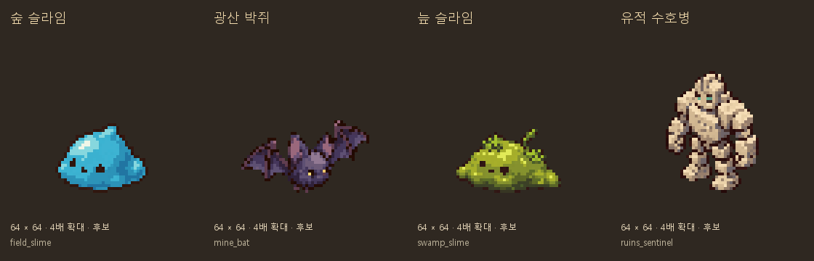

# 기본 원정 몬스터 그림 후보 (2026-10-11)

사용자 계속 없는 부분 출력 요청으로 Codex 내장 `image_gen`에서 4종을 개별 생성했다. 기존 사용자 승인에 따라 Python으로 게임용 픽셀을 정리했다. 일반 Pixel Lab 담당 규칙의 이번 Codex 생성 예외를 적용했다.

## 출력과 규격

| 그림 | 실제 enemy ID | 캔버스 / 발밑 제안 | 실제 윤곽 | 색 수 |
| --- | --- | --- | --- | --- |
| 숲 슬라임 | field_slime | 64×64 / (32,56) | 32×24 | 31 |
| 광산 박쥐 | mine_bat | 64×64 / (32,56) | 44×25 | 26 |
| 늪 슬라임 | swamp_slime | 64×64 / (32,56) | 36×22 | 32 |
| 유적 수호병 | ruins_sentinel | 64×64 / (32,56) | 32×42 | 27 |

한 종류당 남서 방향 기본 자세 1장이다. 박쥐의 기준점은 프레임 하단 제안이며 실제 공중 높이와 연결할 때 따로 맞춘다. 청록색 숲 슬라임/보라 박쥐/이끼색 늪 슬라임/모래색 수호병의 외형은 이번 시각 후보이며 전투 수치나 기존 프로필 색을 바꾸지 않았다.

- [생성 프롬프트와 참조](프롬프트.json): 기존 자연물과 유적 파편의 도트·외곽선·등각 방향을 참조. 배경 투명, 단일 몬스터, UI/체력바/별도 바닥/발광 번짐 제외.
- `생성_원본/`의 4장과 `픽셀_정리/`의 4장을 분리 보존했다. 내장 도구의 원본도 그대로 남겼다.
- 알파128 경계 크롭, 가로세로 동일 비율 최근접 축소, 바탕24+강조8색 이하. 이진 알파0/255·투명 RGB0.
- 작은 눈 색이 최근접 축소에서 빠지지 않도록 박쥐/수호병은 원본의 연결된 눈 색 영역 중심을 1픽셀씩 표본화했다. 외곽·몸체를 새로 그리거나 늘리지 않았다. 박쥐 눈2픽셀·수호병 청록색3픽셀 확인.
- [픽셀 검사](검사_결과.json)에 원본 크롭/실측 윤곽/배치/색/눈 표본/원본과 후보SHA256 저장.
- [정리 재현 스크립트](픽셀_정리.py)는 보존 원본으로 실행한다. Pillow와 Windows 맑은 고딕을 사용한다. 최초 원본 복사에만 `--source-root`를 쓰며 API/키를 호출하지 않는다.
- [후보 목록](후보_목록.json)에 실제 enemy ID·전투 이벤트·loot table과 SHA256 기록. 보스와 교체하지 않는다.

## 현재 게임과 연결 시 필요한 일

**4장은 후보이며 게임에 적용하지 않았다.** 현재 `expedition_stage_3d.gd`의 `_build_enemies`는 모든 몬스터를 공통 둥근 모델과 눈으로 그린다. 개별 몬스터 이미지 경로는 없다.

`expedition_room_model.gd`는 입력 enemy의 ID로 행동 프로필을 조회하지만, 방의 `enemies` 딕셔너리에 그 ID를 남기지 않는다. 후속 연결은 원래 enemy ID를 유지하고 그 ID로 이미지를 선택해야 한다. 번역 가능한 이름이나 색으로 구분하지 않는다. 이번에는 코드·CSV를 수정하지 않았다.

- 기본 자세만 있으며 걷기/날갯짓/공격/피격/사망 프레임과 반대 방향은 미제작이다. 기존 이동·돌진·찌그러짐·HP·사망 처리와 충돌을 유지할 연결 계획이 필요하다.
- 별도 노멀맵은 미제작이다. 실제 아침/점심/저녁 조명은 기존 코드대로 유지하고 연결 후 화면에서 확인한다.
- 보스는 포함되지 않았으며 캔버스/크기 예산을 별도로 정해야 한다.

## 남은 그림과 검사

현재 `enemies.csv`는 **24종**이며 이번 4종 뒤로 **일반14종·보스6종 = 20종**이 남는다. 예전 그림 목록의 8종은 현재 전체 데이터 수량과 다르다. [미제작 목록](미제작_목록.json)은 실제 CSV에서 계산했다. 다음 일반 후보는 숲 가시덩굴·돌조각 정령·늪 갈대괴물·유적 잔불이다.

기존 원정 오브젝트/환경 후보20종21장에 이번 몬스터4종4장을 더해 **원정 후보 총24종25장**이다. 몬스터만의 제작 범위는 24종 중4종이며 전체 몬스터가 완성됐다는 뜻이 아니다.

- 신규4장 64×64/이진알파/투명RGB0/32색 이하/발밑/해시 검사 통과. 확대 비교에서 실루엣과 작은 눈 색 확인.
- 실제 enemy ID/전투 이벤트 대응4종 검사 통과.
- [보존 검사](보존_검사.json): 이전 후보21PNG와 실행 received147+pixel_shop332PNG의 해시·런타임 매핑 유지.
- `docs_check.py`: 깨진 링크0/목록 누락0. `validate_assets.py`: FAIL0/WARN28/아이콘 누락0. docs 후보는 별도 픽셀 검사를 수행했다.
- `git diff --check` 통과. 이번은 후보 출력이며 Godot 실행 검사를 새로 하지 않았다.

## 후속: 일반 몬스터 전체 기본 그림 준비

2026-10-11 사용자 요청으로 [일반14종 추가 제작](일반_추가/제작_기록.md)을 완료했다. 위4종의 원본/정리PNG는 그대로이며 일반18종 기본 자세 후보가 모두 준비됐다. 현재 [전체 후보 목록](전체_후보_목록.json)은18종, [미제작 목록](미제작_목록.json)은 보스6종이다. 원정 후보 전체38종39장·게임미연결·애니메이션은 사용자 결정으로 보류한다. 위 본문의20종 미제작 수량은 최초4종 제작 당시 기록이다.
