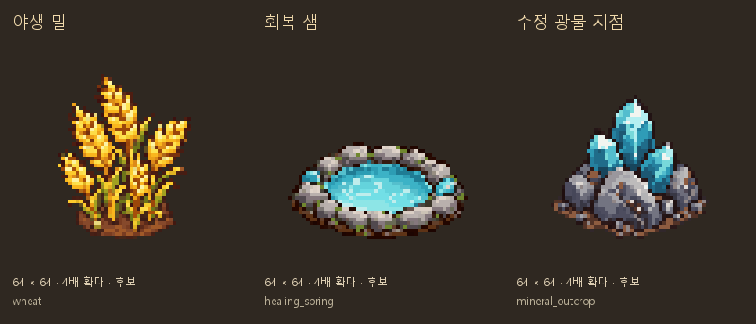

# 원정 상호작용 그림 보충

2026-10-11 · main · 사용자 요청: 계속 없는 부분 출력

## 이번 그림3종

Codex 내장 **image_gen**을 그림별로 호출하고, 사용자가 허용한 Python 보정으로 도트를 정리했다.
기존 덤불·바위와 앞서 만든 물가 후보는 도트 윤곽/색감/등각 방향의 참조다. 원본 픽셀을 복사한 것은 아니다.

| 그림 | 연결 판단 정보 | 용도 | 정리본 |
|---|---|---|---|
| 야생 밀 | site table=`gather_wheat` | 알곡이 있는 황금빛 이삭, 밀 채집 | [밀](픽셀_정리/wheat.png) |
| 회복 샘 | object kind=`heal` | 둥근 돌테두리·청록 돌2개, 휴식/회복 | [샘](픽셀_정리/healing_spring.png) |
| 수정 광물 지점 | object kind=`gather`, event target=`mine_gather` | 회색 바위+푸른 수정, 기존 혼합 광물 채집 | [광물](픽셀_정리/mineral_outcrop.png) |

- 밀은 갈대의 갈색 씨방과 다르게 알곡이 달린 황금색 이삭으로 구분했다.
- 샘은 일반 물가(`gather_water`)와 다른 둥근 테두리와 양쪽 청록 돌을 사용한다. 물 아이템을 지급하는 그림이 아니다.
- 광물은 보랏빛 룬 결정과 다른 푸른 수정과 회색 바위다. `mine_gather`는 석탄/돌 조각/구리 광석/수정 원석의 혼합 테이블이며, 수정만 확정 지급하거나 새 전용 드롭을 만든 것이 아니다.
- 현재 renderer의 `gathering_sites` 없는 경로는 `_make_object(kind, "", ...)`를 호출하여 이벤트 target을 전달하지 않는다. 광물 후보를 연결하려면 controller의 기존 `event.target_id`도 표시 선택 정보로 전달해야 한다. 모든 빈 table/기본 분기에 이 그림을 무조건 연결하면 다른 채집 사건까지 광물로 표시된다.
- `heal`은 현재 공용 샘 도형을 사용한다. 지역별 별도 휴식 장소 그림을 만든 것은 아니다.

## 보존 파일과 규격

- 원본3장은 `생성_원본/`, 정리본3장은 `픽셀_정리/`에 추가했다. 이전4종은 그대로다.
- 모두64×64 RGBA, 남서 등각 한 시점, 발밑 기준점(32,56).
- 알파128 경계 크롭 → 가로/세로 비율 유지 최근접 축소 → 바탕24색/강조8색 분리 추출.
- 밀37×46/샘50×27/광물44×40, 실제 색 수32/32/31. 알파0/255·투명RGB0.
- [프롬프트·참조](보충_프롬프트.json), [크롭/색/원본과 후보 해시](보충_검사_결과.json), [연결 선택 정보](보충_후보_목록.json).
- [픽셀 정리 스크립트](보충_픽셀_정리.py)는 보존 원본에서 이번3종을 재현한다. Pillow와 Windows 맑은 고딕 글꼴을 사용하며, 최초 원본 복사만 `--source-root`로 지정한다. 기존4종의 스크립트/검사/후보 목록은 수정하지 않았다.

## 적용과 검사

**이번3종은 그림 후보이며 아직 게임에 연결하지 않았다.** 후보 총17종(채집 지점15종+닫힌 상자1종+회복 샘1종)이다.

- 신규3종 픽셀 규격/알파/색 수/기준점/원본과 정리본SHA256 및 실제 이벤트 대응 검사 통과.
- 이전14종 후보, received147장+pixel_shop332장 실행 그림의 해시와 런타임 매핑을 보존했다.
- `validate_assets.py`: FAIL0/WARN28/아이콘 누락0. docs 후보는 별도 픽셀 검사로 확인했다.
- `docs_check.py`: 깨진 링크0/목록 누락0. `git diff --check` 통과.
- 코드/수치/저장/조명 변경 없음. Godot 실행/실제 조명 검사는 이번에 새로 수행하지 않았다.
- 추가 회전/전용 노멀맵/채집 모션은 미제작이다. 연결 시 실제 이벤트 선택, `object_consumed` 이후 숨김, 가림/기준점/낮밤 조명을 확인한다.

이제 원정의 장애물·횃불·출구 표시에 전용 그림이 필요한지 확인한다. 일반 바위/버섯/열매나무는 기존 자연물 재사용 여부부터 대조한다.
