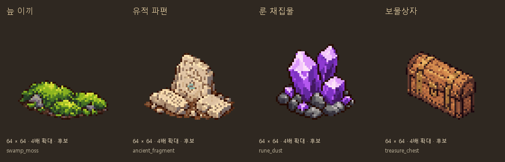

# 원정 오브젝트 그림 후보

2026-10-11 · main · 사용자 요청: 계속 빈곳 그림 출력

## 출력한 그림

Codex 내장 **image_gen**으로 각각 생성했다. 기존 바위·덤불·나무 계산대는 도트 윤곽과 등각 방향·색감의 참조이며, 원본 픽셀을 복사한 것은 아니다. 앞서 사용자가 허용한 Python 픽셀 보정으로 정리했다.

| 후보 | 모델 종류 | 재료 / 실제 채집 테이블 | 정리본 |
|---|---|---|---|
| 늪 이끼 | gather_site | swamp_moss / choice_swamp_moss | [이끼](픽셀_정리/swamp_moss.png) |
| 유적 파편 | gather_site | ancient_fragment / choice_ancient_fragment | [파편](픽셀_정리/ancient_fragment.png) |
| 룬 채집물 | gather_site | rune_dust / choice_rune_dust | [결정](픽셀_정리/rune_dust.png) |
| 보물상자 | chest | 보상 테이블은 방 모델의 기존 값을 사용 | [닫힌 상자](픽셀_정리/treasure_chest.png) |

- 이끼는 바닥에 붙은 초록 쿠션과 작은 바위로, 일반 약초·눈꽃 이끼와 구분한다.
- 유적 파편은 자연 바위와 다른 조각된 석판, 깨진 모서리와 작은 청록 문양을 사용한다.
- 룬 채집물은 가루 아이콘이 아닌 원정 지점용 보랏빛 결정이다. 아이템 설명/드롭은 변경하지 않았다.
- 보물상자는 나무 몸체·황동 띠·잠금장치가 있는 닫힌 한 상태다. 이번에 새 보상 테이블을 만들지 않았다.

## 규격과 재현

- 생성 원본4장은 `생성_원본/`, 정리본4장은 `픽셀_정리/`에 보존했다.
- 캔버스64×64 RGBA·남서 등각 한 시점·발밑 기준점(32,56).
- 알파128 이상 경계 크롭 → 비율 유지 최근접 축소 → 바탕24색/강조8색을 각각 추출.
- 이끼50×22/파편50×37/룬44×42/상자39×38을 공통 캔버스에 배치했다. 가로·세로를 따로 늘리지 않았다.
- 실제 색 수31/30/32/32, 알파0/255·투명RGB0·원본/정리본SHA256 검사 통과.
- 청록 문양은 축소 후6픽셀 남는다. 작은 문양 기준은4픽셀, 큰 색 영역은10픽셀 이상으로 검사한다.
  처음 일괄10픽셀 검사에서 작은 문양이 실패했으며, 확대 시트로 형태가 남는 것을 확인한 뒤 기준을 구분했다. 별도 재생성/원본 덧칠은 하지 않았다.
- [생성 프롬프트·참조](프롬프트.json), [크롭·색·해시 검사](검사_결과.json), [모델 대응 목록](후보_목록.json).
- [픽셀 정리 스크립트](픽셀_정리.py)를 이 폴더에서 실행하면 보존 원본으로 같은 후보와 시트를 재현한다.
  Pillow와 Windows 맑은 고딕 글꼴을 사용한다. 최초 복사만 `--source-root`에 생성 이미지 폴더를 지정한다.

## 적용 상태와 검증

**이번4종은 그림 후보이며 아직 게임에 연결하지 않았다.** 기존 계절/날씨6종·일반4종과 합쳐 원정 상호작용 그림 후보는14종(채집13종+보물상자1종)이다.

- 신규4장 규격/해시/실제 재료와 채집 테이블 및 상자 종류 대응 검사 통과.
- 이전10종 후보·실행 received147장+pixel_shop332장의 해시와 런타임 매핑을 보존했다.
- `validate_assets.py`: FAIL0/WARN28/아이콘 누락0. docs 후보는 실행 에셋 분류 밖이므로 위 픽셀 검사를 별도로 수행했다.
- `docs_check.py`: 깨진 링크0·목록 누락0. `git diff --check` 통과.
- 이번에 게임 코드/아이템 수치/저장/조명은 바꾸지 않았고 Godot 실행 검사는 새로 수행하지 않았다.
- 별도 회전·전용 노멀맵·채집 모션·상자 열림 그림은 미제작이다. 현재 원정은 `object_consumed` 후 지점을 숨기므로 상자 열림 표시를 추가하려면 실제 표시 흐름부터 확인해야 한다.

후속으로 밀 채집/회복 샘/혼합 광물 채집 후보3종을 추가했다. [보충 제작 기록](보충_제작_기록.md)과 [비교 시트](보충_오브젝트_비교.png) 참고. 현재 전체 후보17종이며 게임 연결은 후속이다. 기존 자연 바위/열매나무는 재사용 가능 여부를 실제 테이블별로 확인한다.
