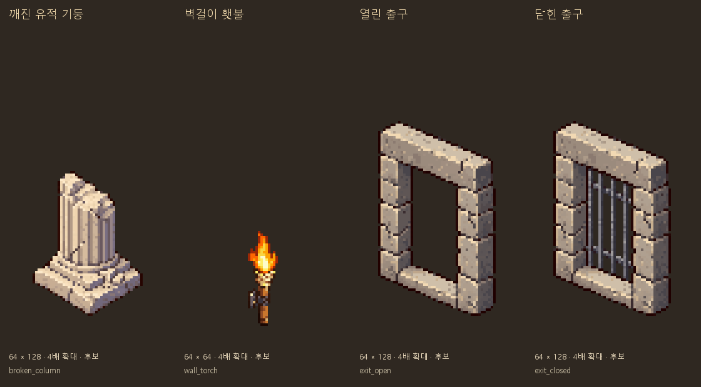

# 원정 환경 소품 그림 후보

2026-10-11 · main · 사용자 요청: 계속 없는 부분 출력

## 출력 범위

현재 원정에서 도형으로 표현하고, 에셋 이름 검색에서 전용 후보를 찾지 못한 기둥/횃불/출구를 만들었다.
Codex 내장 **image_gen**으로 기둥·횃불·열린 문틀을 각각 생성하고, 열린 문틀을 참조한 편집으로 쇠창살 상태를 생성했다. 기존 바위·유적 파편은 도트/돌 색감/등각 방향 참조다. 사용자가 허용한 Python 보정으로 비율을 유지해 정리했다.

| 대상 | 실제 표시 선택 근거 | 규격 / 제안 기준점 | 정리본 |
|---|---|---|---|
| 깨진 유적 기둥 | hidden_ruins의 obstacle=column | 64×128 / (32,104) | [기둥](픽셀_정리/broken_column.png) |
| 벽걸이 횃불 | _add_torch의 본체·불꽃 | 64×64 / 부착점(32,45) | [횃불](픽셀_정리/wall_torch.png) |
| 열린 출구 | model.exit_open=true | 64×128 / (32,104) | [열림](픽셀_정리/exit_open.png) |
| 닫힌 출구 | model.exit_open=false | 64×128 / (32,104) | [닫힘](픽셀_정리/exit_closed.png) |

3종을4장으로 만들었다. 기준점은 후보의 제안값이며 실제 벽/발밑/광원 위치와 맞는지는 게임 연결 때 확인한다.
기둥은 받침대가 있는 세로 장애물로, 채집용 석판과 다르다. 횃불은 고정구를 포함한 단일 정지 프레임이다. 출구는 직사각형 돌 문틀과 쇠창살 두 상태이며 화살표·아이콘·빛 번짐을 이미지에 넣지 않았다.

## 픽셀 정리와 출구 몸체 보존

- `생성_원본/`에 원본4장, `픽셀_정리/`에 정리본4장 보존.
- 알파128 경계 크롭·가로세로 동일 비율 최근접 축소·알파0/255·투명RGB0. 기둥 원본의 부드러운 바깥 번짐은 알파 컷으로 제거했다.
- 실제 윤곽 크기: 기둥44×58/횃불12×38/문틀47×78. 원정 상호작용64×64 그림과 키가 다른 소품이므로 문틀·기둥의 캔버스를64×128로 뒀다.
- 색 수: 기둥32/횃불30/열림24/닫힘32. 횃불은 바탕24+불꽃8색으로 작은 노란 중심을 보존했다.
- 출구는 **열린 그림의 몸체 픽셀을 그대로 복사**한 후 내부 투명 구멍에서만 닫힌 원본의 쇠창살을 합성했다. 두 상태가 같은 크롭/배율/배치를 사용한다.
- 출구 변경361픽셀이 전부 내부 [변경 마스크](출구_변경_마스크.png)에 포함되는 것을 확인했다. 문틀/문턱/외곽은 RGBA가 동일하고 쇠창살 사이도 투명하다.
- [프롬프트·참조](프롬프트.json), [모델 선택·규격 대응](후보_목록.json), [색/크롭/원본과 후보SHA256 검사](검사_결과.json), [정리 재현 스크립트](픽셀_정리.py).
- 재현은 보존 원본으로 `픽셀_정리.py`를 실행한다. Pillow·Windows 맑은 고딕 글꼴을 사용하고 최초 복사 때만 `--source-root`를 지정한다. API/키를 쓰는 생성 스크립트가 아니다.

## 적용 상태와 검사

**이번4장은 후보이며 아직 게임에 연결하지 않았다.** 기존 원정 상호작용17종17장+환경 소품3종4장으로 원정 후보는20종21장이다.

- 신규4장 규격/이진알파/색 수/해시/실제 source 선택 정보 검사 통과.
- 열린/닫힌 문틀 몸체 동일·내부만 변화·창살 사이 투명 검사 통과.
- 이전17후보와 실행received147+pixel_shop332장의 해시/매핑 보존.
- `validate_assets.py`: FAIL0/WARN28/아이콘 누락0. docs 후보는 별도 픽셀 검사를 수행했다.
- `docs_check.py`: 깨진 링크0/목록 누락0. `git diff --check` 통과.
- 코드/아이템 수치/원정 충돌/시간/저장/조명은 변경하지 않았으며 Godot 실행 검사는 새로 하지 않았다.

### 연결 때 남은 일

- 출구 원본 모델이 만든 문틀을 그대로 남기고 그림 문틀을 추가하면 중복된다. 표시 몸체를 교체하되 기존 `model.exit_open`과 충돌·출구 위치는 유지한다. 초록 출구 빛의 처리도 기존 상태와 함께 확인한다.
- 횃불 PNG는 주변을 밝히지 않는다. 실제 OmniLight3D 위치/빛 색/밝기와 깜빡임을 보존해야 한다. 이번은 주황 불꽃1프레임이며 늪 초록/유적 보라 불꽃·불꽃 애니메이션은 별도 후보가 없다.
- 기둥의 한 칸 장애물 충돌/가림/발밑 기준점, 문틀의 실제 통로 폭/뒤벽 이음새, 횃불 부착점을 GPU 화면에서 확인한다. 카메라 반대 방향/별도 노멀맵은 이번에 만들지 않았다.
- 다음은 원정 몬스터 그림이 실제로 모두 연결되어 있는지 확인한다. 일반 나무/바위/그루터기는 기존 받은 자연물의 재사용부터 대조한다.
