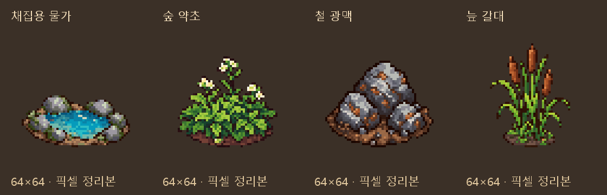

# 일반 채집물 그림 후보

2026-10-11 · main · 사용자 요청: 계속해서 빈 그림 부분 출력

## 출력 범위

현재 원정 무대에서 코드 도형으로 표현하는 채집물 가운데 초반에 필요한4종을 출력했다.
Codex 내장 **image_gen**을 그림별로 호출했다. 기존 바위·덤불을 도트/윤곽/색감/등각 방향의 참조로 사용했고,
사용자가 허용한 Python 픽셀 보정으로 정리했다. 기존 자연물의 원본 픽셀을 그대로 복사한 것은 아니다.

| 후보 | 재료 ID | 실제 채집 테이블 | 픽셀 정리본 |
|---|---|---|---|
| 채집용 물가 | raw_water | gather_water | [물가](픽셀_정리/raw_water.png) |
| 숲 약초 | forest_herb | choice_forest_herb | [약초](픽셀_정리/forest_herb.png) |
| 철 광맥 | iron_ore | choice_iron_ore | [광맥](픽셀_정리/iron_ore.png) |
| 늪 갈대 | marsh_reed | choice_marsh_reed | [갈대](픽셀_정리/marsh_reed.png) |

- 물가는 낮은 돌테두리 안에 고인 작은 샘으로, 약초는 작은 잎과 흰 꽃으로 표현했다.
- 철 광맥은 일반 바위와 구분되는 금속 결/주황빛 녹 자국을 넣었다.
- 늪 갈대는 좁고 긴 잎·줄기·갈색 씨방으로 다른 채집 식물과 구분한다.
- 물가 후보의 용도는 `gather_water`이며 회복 오브젝트 `heal`에 자동 공용 연결한 것이 아니다.

## 파일과 규격

- 원본4장: `생성_원본/`. 게임용 후보4장: `픽셀_정리/`.
- 모두64×64 RGBA, 남서쪽 등각 한 시점, 발밑 기준점(32,56).
- 알파128 이상 경계 크롭 후 비율 유지·최근접 축소했다.
  물가50×24, 약초46×42, 광맥50×40, 갈대37×48.
- 바탕24색/구분용 강조8색을 따로 추출하여32색 이하 공통 팔레트를 만들었다.
  물의 푸른 면247픽셀/약초 흰 꽃49/광맥 녹 자국100/갈대 위쪽 씨방94가 해당 색 조건에 남는지 확인했다.
  이 숫자는 식물·물방울 개수가 아닌 검사 색 영역의 픽셀수다.
- 알파0/255·투명RGB0·SHA256·실제 재료ID/채집table 대응4종 검사 통과.
- 기존 계절/날씨6종 해시 및 실행147+332장 해시 그대로, 매핑 내용 유지.
- [생성 프롬프트와 참조](프롬프트.json), [크롭·규격·픽셀 검사](검사_결과.json),
  [후보 대응 목록](후보_목록.json)에 제작/연결 정보를 보존했다.
- 에셋 검증 FAIL0/WARN28/아이콘 누락0. 새 docs 후보는 별도 픽셀/해시 검사로 확인한다.
  문서 검사: 깨진 링크0·목록 누락0.

## 적용 상태와 남은 그림

**이번4종은 후보이며 아직 게임에 연결하지 않았다.**
계절/날씨6종과 합쳐 채집 지점용 새 후보는10종이다.
별도 회전·노멀맵·채집 모션은 이번 출력에 포함하지 않았으며, 런타임 조명/보행 검사는 새로 실행하지 않았다.
표시만 출력했고 실제 물 채집 도구·광석 드롭·아이템 가격·재료량·저장은 변경하지 않았다.
다음 연결에서 모델의 실제 table과 `object_consumed` 소진 여부를 사용해야 한다.

다음 그림 후보: 늪 이끼(`choice_swamp_moss`), 유적 파편(`choice_ancient_fragment`),
룬 채집물(`choice_rune_dust`), 보물상자. 기존 바위/버섯/열매나무를 그대로 재사용할 수 있는지 먼저 확인한다.
