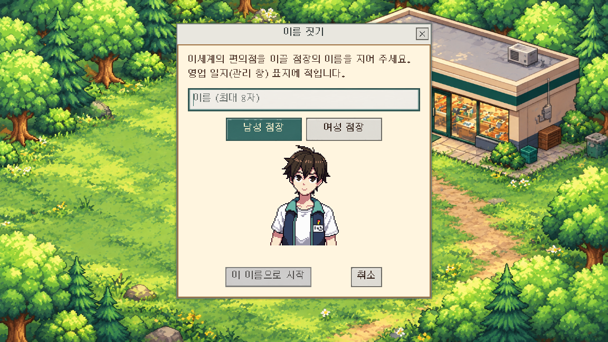
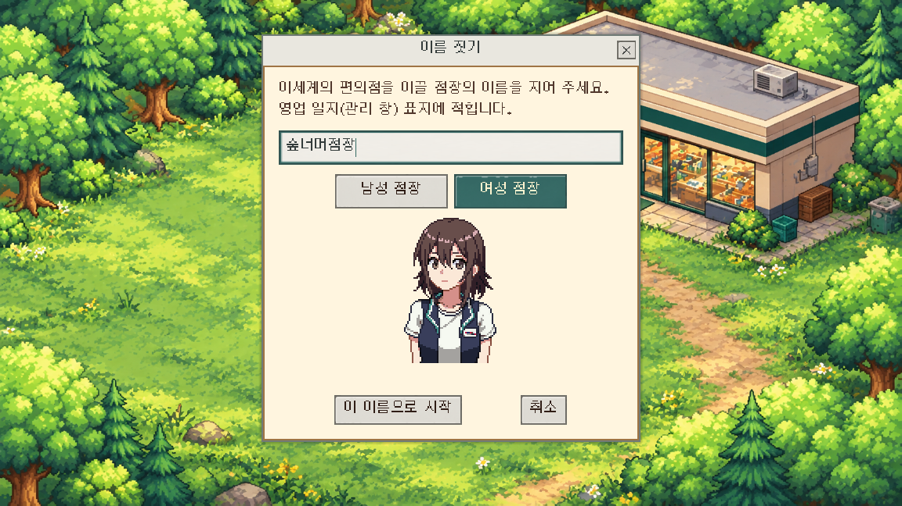
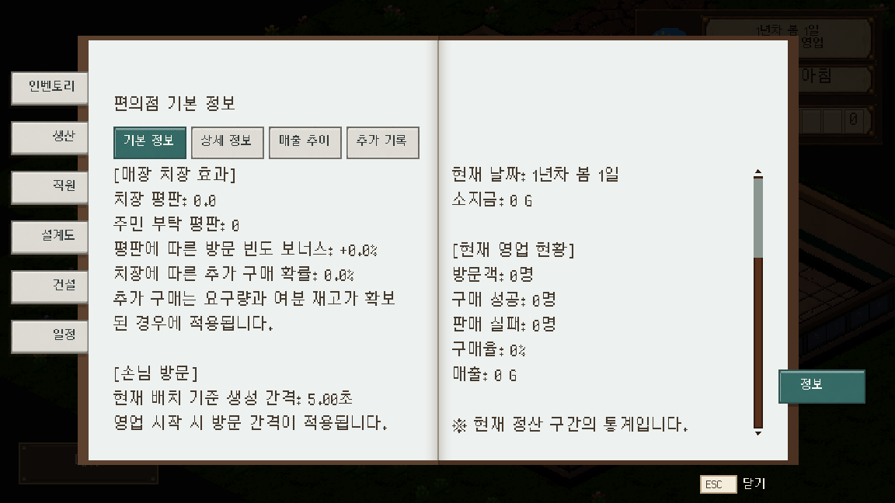

# 일반 창 형태와 조작용 UI

2026-10-12 · 사용자 요청으로 Codex 제작·연결

> 사용자 후속 정정: 수첩 포스트잇을 일반 버튼처럼 바꾼 부분은 원래 구역색·종이 모양·글씨·넘김 질감으로 복원했다. 아래 회색·청록 책갈피 화면은 교체 당시 기록이다. 최신 작업 기준은 [UI 디자인 규칙](../../../UI_디자인_규칙.md)이다. 새 조작 그림 12장은 현재 구현이며 최종 디자인 승인으로 취급하지 않는다.

## 방향

기존 금속 장식 테두리를 버튼·입력란·탭에 반복해서 사용해 모든 조작부가 강조됐다. 이름 입력창은 Window의 본문 스타일만 바꾸면서 제목줄 바탕은 확보하지 못했다. 사용자 요청에 따라 일반 데스크톱 창처럼 제목줄과 본문을 구분하고, 조작부는 중립색을 기본으로 한다.

- 제목줄: 회색 바탕·어두운 제목·단순한 X 닫기. 이름 입력창 본문은 밝은 종이색.
- 버튼: 기본 중립색, 마우스를 올리면 밝아짐, 누름/선택은 청록색, 비활성은 회색.
- 입력란: 밝은 바탕·어두운 글씨, 포커스 때만 청록 테두리. 안내 글씨·선택 글씨·커서 대비도 별도로 설정.
- 탭: 현재 탭만 청록색. 수첩의 좌우 책갈피·넘김 질감에도 동일하게 적용한다. 소탭에서 현재 항목을 클릭하지 못하게 하는 기존 동작은 유지하되 잠긴 기능과 외형을 구분한다.
- 책·종이·HUD 등의 배경 그림과 인물 초상화는 유지한다.

Window의 `embedded_border`는 제목 영역을 자동으로 덮지 않으므로 위로 40px 확장해 제목줄 바탕을 확보했다. 기준은 [Godot 공식 Window 문서](https://docs.godotengine.org/en/stable/classes/class_window.html#class-window-theme-style-embedded-border).

## 제작 및 저장

내장 `image_gen`으로 조작부 아틀라스 1장을 생성했다. [프롬프트](프롬프트.txt)·[생성 원본](생성_원본.png)·[프레임/해시 목록](제작_목록.json)을 보존했다. 원본의 외부 광휘를 프레임 자르기로 제외하고, 기존에 승인된 Python 픽셀 보정 방식으로 최근접 축소·16색 팔레트를 적용했다. 이 결과는 그림이 채워진 사각형 조작부이며, 원본의 반투명 광휘를 게임 화면에 사용하지 않는다.

| 조작부 | 상태 | 규격 |
|---|---|---|
| 버튼 | normal / hover / selected / disabled | 각 96×32 |
| 입력란 | normal / focus / readonly | 각 96×32 |
| 탭 | normal / hover / selected / disabled | 각 96×32 |
| 닫기 | X | 24×24 |

총 12PNG를 `art/ui/controls/`에 연결했다. 상태별 그림·import UID는 고유하며 기존 PNG를 덮어쓰거나 삭제하지 않았다. 9패치의 가장자리 3px를 보존하여 버튼 폭이 달라져도 테두리가 함께 늘어나지 않는다. 글자는 이미지에 넣지 않고 기존 Silver 폰트로 표시한다.

재현 검사는 `python docs/그림_작업/받은그림/조작_UI/분리.py`. `--write`는 목록의 실행 그림과 받은 그림을 갱신한다.

## 연결

- 공용 `pixel_ui_theme.tres`: 기본 버튼·입력란·탭·Window 제목줄을 변경. 기존 배경 Panel·본문 종이·장식 그림은 보존.
- `InteractionUiStyle`: 코드로 만든 테마와 버튼도 같은 조작 그림을 사용. 관리 수첩·생산 작업창·건설 버튼에 연결.
- 수첩: 현재 탭만 강조하며 이전 쪽의 책갈피와 넘기는 쪽의 임시 질감에도 같은 판정 적용. 기본 정보·직원·설비·건설·상품 준비·이정표 소탭도 같은 기준.
- 이름 입력: 회색 제목줄·단순 닫기·밝은 입력란·확인/취소 최소 높이. 기존 이름 검증·남녀 선택·시작 흐름 유지.

## 실제 확인

Godot 4.7.1의 격리 저장 환경에서 확인했다. 첫 가져오기에는 새 텍스처보다 프로젝트 테마를 먼저 읽어 발생한 로더 경고가 있었으며, 가져오기 완료 후 최종 두 번은 ERROR/SCRIPT ERROR 없이 종료했다.

- 키보드 이름 입력·확인 활성화·제목 대비·입력란·긴 대사·날짜/돈 표시: 145항목 실패 0.
- 실제 GPU 이름창·남녀 버튼·수첩 7탭: 16항목 실패 0, 펼침/넘김 종료 후 화면 확인.
- 전체 로드: 격리 복사본 920개 실패 0(임시 검사 장면 포함).
- 인벤토리 선택·품목 설명: 53항목 실패 0.
- 원정 결과: 긴 보상 50줄, 세 해상도(1152×648·593×523·800×450)에서 스크롤·실제 마우스 확인 버튼 실패 0.
- 에셋: FAIL 0, 기존 WARN 23 유지.

후반 콘텐츠 전체 손조작·다른 PC DPI 점검은 별도다. 이번 화면은 초기 해금 상태이며 일반 키 입력 이벤트로 확인했다. 실제 Windows 한글 IME 입력은 배포 전 손조작 점검에 포함한다. 기존 Windows RC1은 재빌드하지 않았고 다음 빌드에 포함한다.

푸시 전 최신 main `ea955e7b`의 용어·시작 가구 정리를 받았다. 충돌 없이 합쳐졌으며 같은 UI 검사 145항목이 실패 0으로 통과했다.
