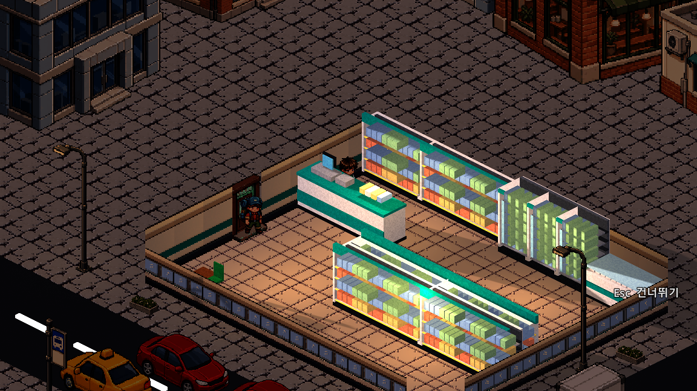
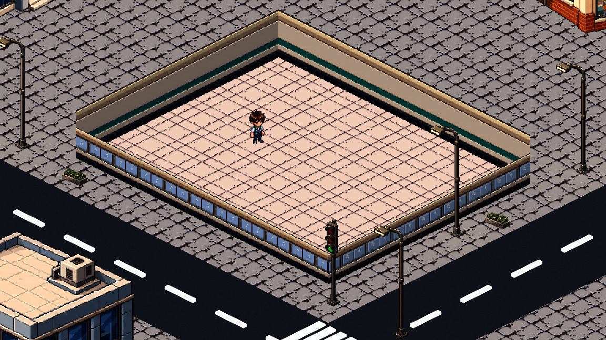
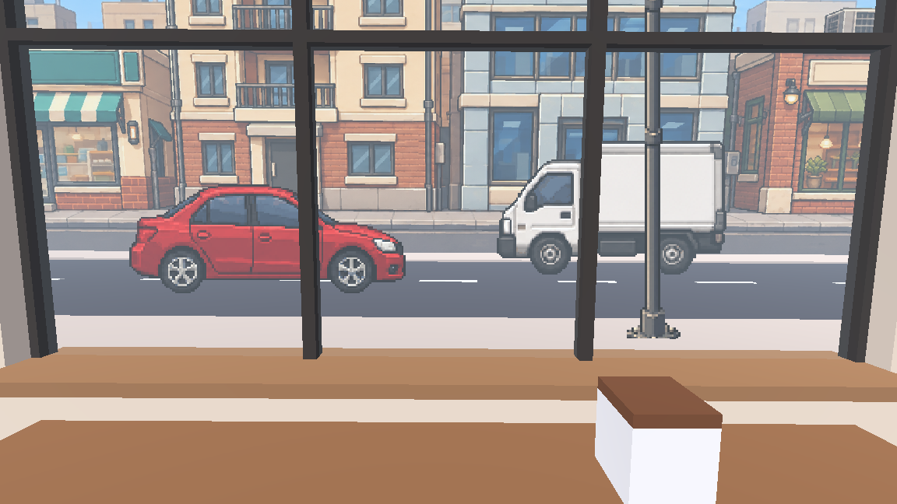
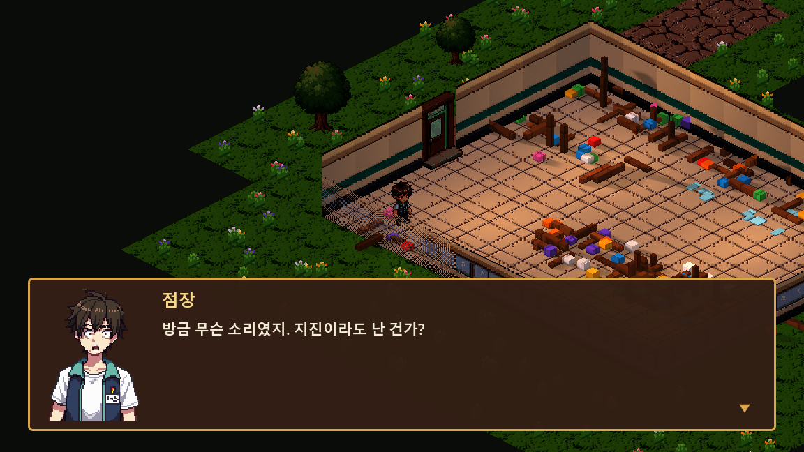
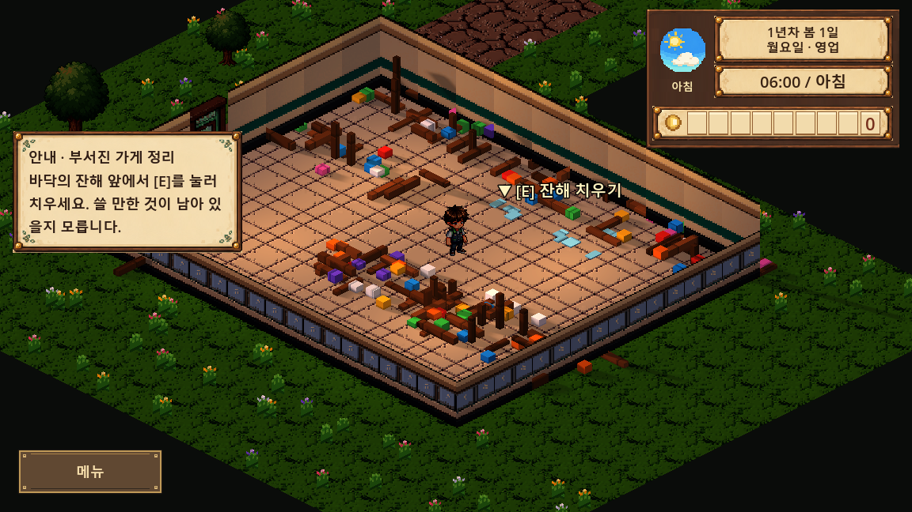

# 프롤로그 도시 거리 그림 연결

2026-10-12 · 사용자 요청: 모든 인물의 앉는 자세를 만들기보다 현대 도시 거리부터 꾸민다. 좌식 그림 추가는 이번 작업에 없다.

## 준비한 그림

| 종류 | 구성 | 게임용 그림 |
|---|---|---:|
| 현대 건물 | 낮은 상점·저층 아파트·사무 건물·카페 | 4 |
| 자동차 | 빨간 승용차·노란 택시·흰 배달 트럭, 종류마다 등각 앞뒤 4방향·옆면 양방향 | 18 |
| 생활 소품 | 가로등·신호등·버스 정류장 표지·화단 | 4 |
| 창밖 원경 | 눈높이의 현대 건물 거리 | 1 |
| 합계 | 새 PNG | 27 |

기존 마을 상점과 64×32 포장 타일을 스타일 참고로 사용한 내장 imagegen 원화다. `제작_입력.json`에 프롬프트·참조·원본 SHA를 기록했다. `생성_원본/`에 선택 원본 12장과 아래쪽이 잘려 보정한 아파트의 첫 시도 1장을 함께 보존했다. 실제 로고·글자·전이 원인을 암시하는 상징은 넣지 않았다.

투명 그림은 허용된 Python 처리로 실제 불투명 영역을 나누고 전체에 같은 배율의 최근접 축소·96색·이진 알파를 적용했다. 방향별 실제 분리 영역과 배율은 `data/art/opening_city_assets.json`에 있다. 가로/세로를 따로 압축하지 않았다. 창밖 배경은 1983×793 원본 바이트를 그대로 사용한다. 건물·차량의 화면 크기는 기존 거리의 배치와 높이에 맞춰 전체 배율만 조정한다.

## 게임 연결

- `OpeningCityArt`: 원본 비율의 그림·실루엣 마스크·법선 연결, 차량의 이동 축/속도에 맞는 앞뒤 방향 선택. 원본 바닥과 기준점에 서게 한다.
- `OpeningCityBackdrop`: 기존 거리 폭과 차량 4대의 이동·반복을 유지한다. 건물·소품의 `cut_` 접두어와 공개 함수도 유지한다. 실제 등록 키 81개, 그중 그림 표시 35개다. 임시 입방체는 그림 누락 시의 호환 표시로 남겼다.
- 도시 인도는 기존 포장 원본과 법선을 사용한다. 아스팔트는 도시 전용 바닥 셰이더의 미세 입자로 표현하고, 횡단보도는 6개의 얇은 바닥 줄이다. 도시 바닥을 건물/인물보다 뒤에서 그리며, 매장 바닥은 덮지 않는다. 바닥 PlaneMesh의 실제 위치를 사각형 중심에 놓는다.
- `OpeningCityGround`: 실제 바닥 셰이더의 타일·법선·색 매개변수를 저장한 뒤 포장으로 바꾼다. 도시가 끝나면 저장한 값으로 복원한다. 매 프레임 변하는 정렬 순번은 저장 대상이 아니다. 도시 소품·가로등 광원은 부모 항목과 함께 제거되고 숲 자연물이 복구된다.
- `OpeningWindowCityArt`: 별도 창밖 세계의 원경과 양쪽 옆면 차량을 연결한다. 움직이는 차량 5대·반복·졸음 카메라·눈꺼풀 연출을 유지한다. 렌더 축소를 3에서 1로 바꾸어 원화를 읽을 수 있게 한다.
- `prologue_shot` 캡처 도구는 대사 사이 걷기/졸음 동작이 끝날 시간을 기다리도록 보강했다. 이전 40회 제한으로는 아직 도시인데 숲이라는 이름의 캡처를 남길 수 있었다. 게임 대사·시간·거래·저장 규칙은 이번에 변경하지 않았다.

## 확인 결과

| 검사 | 결과 |
|---|---|
| 실제 GPU 도시/차량 이동·반복·바닥 위치·낮밤·숲 복원·창밖 | 443개, 실패 0 |
| 프롤로그 진행/글 | 37개, 실패 0 |
| 시작 배치 | 16개, 실패 0 |
| 단계별 튜토리얼 | 101개, 실패 0 |
| 전체 코드·씬 로드 | 904개, 실패 0 |
| 활성 그림 연결 감사 | 1777개, 실패 0 |
| 에셋 검사 | PASS 1994 / WARN 28 / FAIL 0 |
| 준비 도구 기본 읽기 전용 재현 | 원본 12 / 게임 PNG 27, 통과 |
| 신규 이미지 가져오기 UID | 27개 모두 고유 |

정상 진행과 건너뛰기 모두 마지막에 `moment=-`, `phase=` 빈 값, `active=false`, `talking=false`, `dlg=false`로 끝났다. 실제 GPU·가져오기·로드 로그에 `SCRIPT ERROR`/`ERROR:`는 없다. 기존 Door 충돌 경고와 Unicode NUL 경고는 별개로 남아 있다. 저장 데이터는 작업용 격리 폴더를 사용했다.

`python tools/install_opening_city_art.py`는 기본 읽기 전용 검증이고 `--install`은 보존한 선택 원본으로 신규 경로만 다시 만든다. 작업자는 기존 그림·원본을 덮어쓰지 않는다. 자동 검사의 화면 위치/대기는 제어했으므로 소리의 체감과 장시간 플레이는 사용자 실행에서 확인한다.

## 실제 실행 화면

원본 전체 구성은 `게임용_전체.png`, 야간은 `실행_확인/도시_밤.png`, 이전 임시 도시는 `실행_확인/도시_이전.png`에 보존했다.

## 기본 카메라 시야 보정 (2026-10-12)

사용자 피드백: 카메라가 계속 너무 멀다. 원화 64픽셀과 논리 좌표 96픽셀의 대응값 `match_zoom=64/96`을 기본 카메라에도 강제 적용한 것이 원인이었다.

`StoreView3D.PLAY_ZOOM=1.0`을 별도로 두고 일반 매장의 기본 시야에 적용한다. 기존 0.67보다 가게·인물이 약 1.5배 크게 보인다. 원화·법선·기준점·논리 칸 크기는 그대로 사용하며, `_sync_camera`가 같은 Camera2D 줌으로 표시와 실루엣 카메라를 맞춘다. 1152×648 기본 화면에서 타일은 96픽셀 폭으로 투영되고 원화는 64×32 규격을 유지한다. 프롤로그 시작 시 저장한 기본 줌이 1.0이므로 마무리에서도 멀어지지 않는다.

도시 확인 도구도 더 이상 0.72배로 물러서지 않고 실제 플레이 줌으로 캡처한다. 위 도시 도입·낮/밤·숲 전환 그림은 보정 후 화면으로 갱신했다. 원화 기반 도시 도입의 이전 시야는 `실행_확인/시야_이전.png`, 튜토리얼로 돌아온 화면은 아래와 같다.

도시/차량/숲 연결 검사 443개 실패 0, 실제 정상 프롤로그 종료 줌 1.00, 전체 904개 코드·씬 로드 실패 0. 매장 그림 검사에서 옛 3D 단풍/열매 예상값 두 개를 현재 제공된 `autumn_orange`/`berry_ready` 상태 그림 선택으로 바로잡았다. 매장 검사 871개도 실패 0이며, 기본 줌과 실제 타일 투영 폭·앞뒤 정렬·실루엣·법선·계절 바닥·카메라 이동 정합도를 포함한다.
