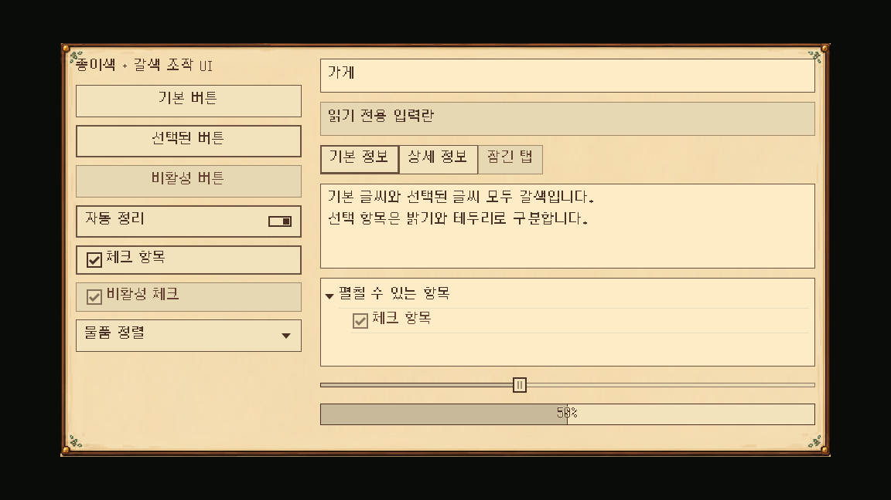
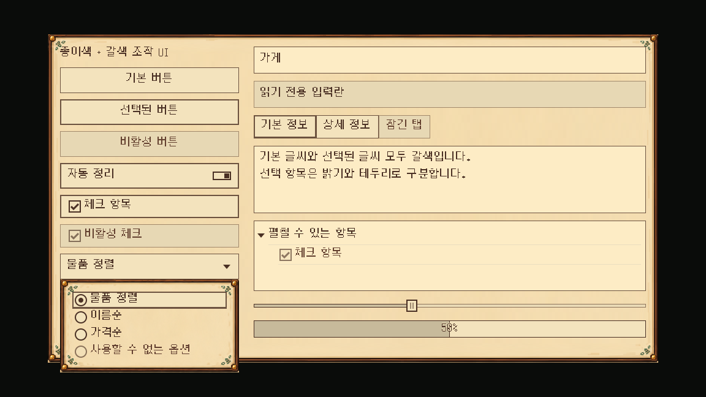
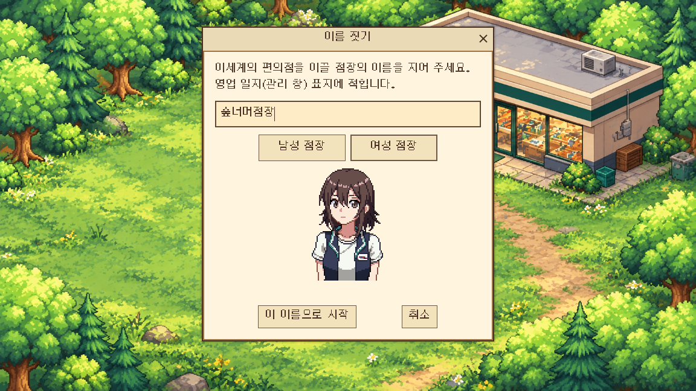
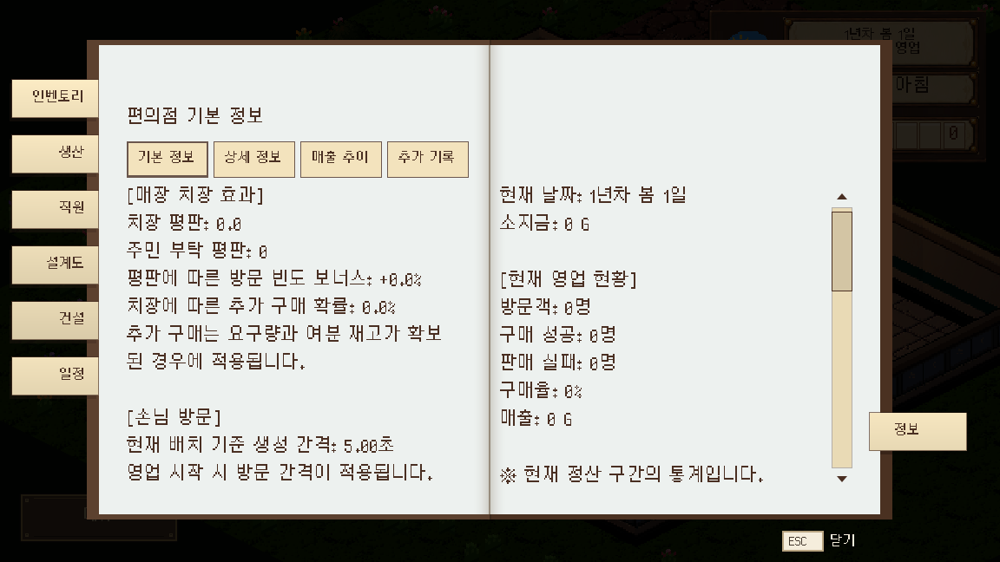

# 배경을 유지한 심플 조작 UI

2026-10-12 · 사용자 요청 반영 · main

## 이번 범위

전체 배경과 수첩 연출을 유지하면서 조작부를 먼저 단순화했다. 기준색은 종이 `#F3E3BD`·갈색 `#4A3024`이며 밝기와 투명도만 변형한다. 선택 버튼도 종이색을 유지하고 테두리 두께로 구분한다.

- 버튼·체크·토글·메뉴 버튼·옵션 버튼: 종이 바탕, 갈색 글씨/선, 눌림·선택은 두꺼운 테두리.
- 탭: 같은 바탕과 글씨, 선택한 소탭은 아래 테두리로 표시.
- 입력란: 밝은 종이 바탕, 갈색 글씨·커서·선택 표시·포커스 테두리.
- 팝업 메뉴: 일반·선택·비활성·구분 제목의 글씨를 명시. 흰 글씨를 상속하던 문제를 수정했다.
- 읽기 전용 입력: LineEdit의 실제 `font_uneditable_color`까지 지정해 흰 글씨를 수정했다. TextEdit의 읽기 전용 글씨도 별도 지정.
- 트리·목록·스크롤·슬라이더·진행 막대: 공통 조작부와 같은 두 색상 기준 적용.
- 포스트잇: 밝기만 다른 종이색과 갈색 글씨/윤곽으로 정리. 원래 종이 형태·접힘·좌우 위치·넘김·클릭 영역·연출 시간은 유지.

숲 타이틀 그림·인물·HUD 배경·책 표지/페이지 배경은 유지했다. 공용 Theme의 Panel·PanelContainer·PopupMenu·PopupPanel·TabContainer·ParchmentContent·WoodHeader 배경 StyleBox 7개는 교체 전과 모든 속성이 동일함을 확인했다. 기존 PNG는 수정·삭제하지 않았다. 전체 UI 배경까지 두 색으로 변환한 단계는 아니다.

## 구현

`InteractionUiStyle`에서 StyleBoxFlat의 바탕·선·여백을 직접 구성한다. 이전 AI 생성 버튼 그림을 실행 스킨으로 사용하지 않아 상태마다 다른 실루엣이나 테두리가 생기지 않는다. 기존 그림은 보존한다.

단순 체크·라디오·토글·화살표·닫기·슬라이더 표시 22개는 `art/ui/controls/plain_icons/`의 SVG로 만들었다. SVG는 두 기준색과 알파만 사용하며 import UID 22개가 고유하다. 별도 이미지 생성 도구 호출은 없다.

공용 `pixel_ui_theme.tres`에도 같은 설정을 저장하여 에디터 테마 미리보기와 코드로 만든 테마가 같은 상태를 사용한다. Theme UID는 유지했다. 폰트 원본·글자 크기·게임 수치·해금·저장 형식은 변경하지 않았다.

## 실제 실행

## 검사

Godot 4.7.1, 사용자 저장과 분리한 `foodbag_checks` 환경에서 확인했다.

| 항목 | 결과 |
|---|---|
| 최종 가져오기 두 번 | 종료 0, ERROR/SCRIPT ERROR 없음 |
| `check_plain_ui` 실제 GPU | 32항목 실패 0: 글씨 대비 4.5 이상, 읽기 전용, 실제 키 입력/체크 클릭/팝업 키 선택 |
| 기존 이름·대사·HUD 글씨 검사 | 145항목 실패 0 |
| 실제 새 게임·수첩 | 13항목 실패 0, 인벤토리→설계도→정보→인벤토리 복귀·넘김 후 캡처 |
| 전체 로드 | 격리 복사본 921개 실패 0(임시 검사 스크립트 포함) |
| 인벤토리 품목 안내 | 53항목 실패 0 |
| 원정 결과 | 보상 50줄, 세 해상도에서 스크롤·실제 마우스 확인 버튼 실패 0 |
| 원본/배경 | 기존 PNG 변경 0·배경 StyleBox 7개 동일·SVG 두 색/고유 UID 검사 통과 |
| 에셋 검사 | FAIL 0, 기존 WARN 23 유지 |

캐시 없는 첫 가져오기는 기존 CSV 번역 처리와 새 텍스처 순서 때문에 오래 걸리고 테마 경고가 발생했다. 가져오기 완료 후 최종 두 번은 오류 없이 종료했다. Unicode/NUL 번역과 Door 충돌 노드 경고는 기존 경고다.

이번 화면은 공용 조작부와 초기 수첩 기준이다. 후반 콘텐츠 전체 손조작·사용자 PC의 한글 IME·다른 PC DPI는 별도 확인이 필요하다. 개별 화면에 명시된 기존 색상 override와 전체 배경의 팔레트 정돈은 후속 범위다. Windows RC1은 재빌드하지 않았고 다음 빌드에 포함한다.

푸시 전 최신 main `eafdc83a`의 주민 부탁 코드 폴더 분류를 받았다. UI와 충돌 없이 합쳐졌고, 이전 경로를 가리키던 격리 UID 캐시가 갱신된 뒤 최종 가져오기 두 번 오류 0·실제 새 게임 글씨 145항목 실패 0·전체 로드 921개 실패 0을 재확인했다.
