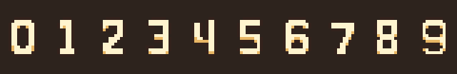
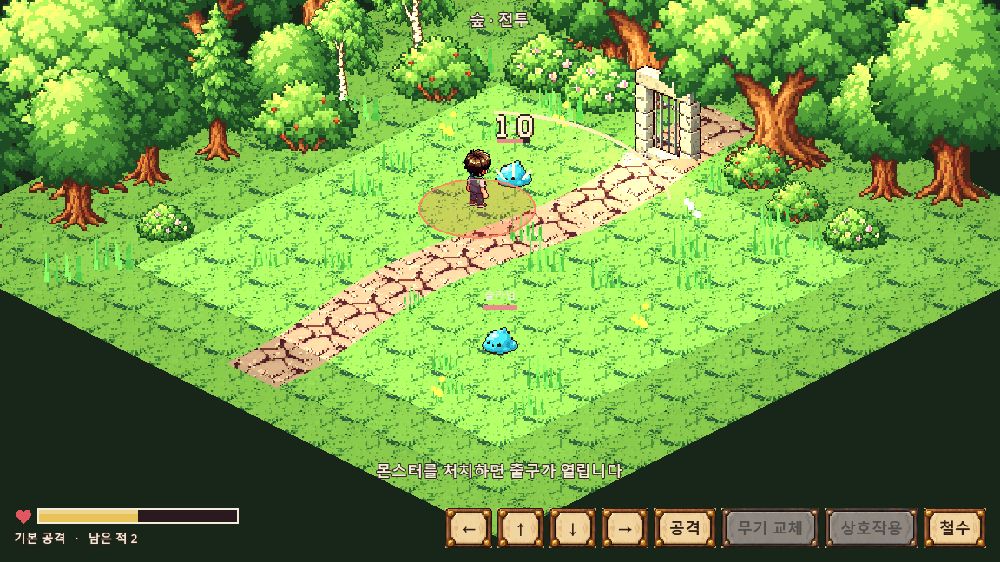
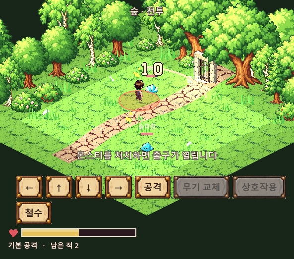

# 원정 UI 정리와 도트 피해 숫자

2026-10-12 사용자 요청, 작업 브랜치 `main`.

## 표시 방식

- 방 화면의 WASD·방향키·J/Space·Q·E 설명과 버튼의 단축키 표기를 없앴다. 기존 키 입력과 버튼 기능은 그대로 작동한다.
- 하트·HP 막대를 왼쪽 아래로 옮겼다. 체력은 기존처럼 막대로 표시하고, 무기·남은 적은 바로 아래에 표시한다.
- 행동 버튼은 오른쪽 아래에 배치한다. 작은 표시 영역에서는 HP 위로 올리고 줄을 나눠 겹침을 방지한다.
- 도구 부족, 채집 진행·결과, 열린 출구 등 진행 상태는 유지한다. 상태 문구에 외곽선을 붙여 밝은 배경에서도 읽히게 했다.

## 숫자 그림과 연결

imagegen으로 **0~9를 한 장씩** 만들었다. 받은 원본 10장과 프롬프트는 [피해 숫자 원본 폴더](받은그림/피해_숫자/prompts.json)에 보관한다. 기존 사용자 승인 방식인 Python 픽셀 보정으로 전체 비율을 유지해 축소하고 같은 팔레트·기준선으로 정리했다.

| 항목 | 규격 |
|---|---|
| 게임 파일 | `art/ui/damage_digits/digit_0.png` ~ `digit_9.png` |
| 개별 캔버스 | 12×16, 투명 배경, 알파 0/255 |
| 공통 색 | 어두운 갈색 외곽선·옅은 금색 음영·아이보리, 3색 |
| 표시 | 정수 2배, 최근접 샘플링, 자리 사이 2px |
| 연결 기록 | `data/art/damage_digit_assets.json`의 원본/게임 SHA256 |

실제 명중 처리 `_hit_enemy()`가 피해 기록을 만든다. 근접·원거리·여러 대상 모두 같은 경로를 사용하며, 방어 계산과 남은 HP를 반영한 **실제 HP 감소량**을 표시한다. 예를 들어 1209는 1·2·0·9 그림을 순서대로 조합한다. 빗나감에는 숫자가 없고, 같은 공격으로 두 적을 맞히면 각 적 위에 각각 뜬다.

숫자는 적의 머리 위에서 0.85초 동안 위로 떠오르고 마지막에 흐려진다. 기존 타격 선 효과도 유지한다. 보스의 마지막 피해 숫자를 볼 수 있도록 처치 후 0.45초 뒤 결과 흐름으로 전환한다. 이때 추가 공격·이동은 막고, 피해 효과만 시간을 진행한다. 보상 계산식·보상 횟수·저장 필드는 바꾸지 않았다.

## 실제 실행 화면

작은 창 캡처는 검사 장면에서 확대 설정을 잠시 해제해 표시 영역을 실제 픽셀 크기로 확인했다. 게임의 기본 창 확대 설정은 그대로다.

## 검증

사용자 저장 파일과 분리한 Godot 4.7.1 복사본에서 실행했다.

| 검사 | 결과 |
|---|---|
| 숫자 원본·재현·SHA·알파·규격 | 10장 통과 |
| HUD·피해 표시 GPU | 1152×648·593×523 각각 110개, 실패 0 |
| 실제 피해·빗나감·근접/원거리·여러 적·과잉 피해·효과 만료 | 통과 |
| 기존 직접 조작·피해 계산 | 실패 0 |
| 실제 채집·출구·입력·전리품·철수 흐름 | 66개, 실패 0 |
| 기존 원정 그림 연결 | 1,023개, 실패 0 |
| 원정 자동 진행 | 16/16 완주, 104노드, 중단 0 |
| 전체 코드·장면 로드 | 891개, 실패 0 |
| 최종 가져오기 2회 | 오류 0 |
| 에셋 검사 | PASS 1877·WARN 28·FAIL 0, 숫자 전용 규칙 10장 통과 |
| 경제 계산기 | 종료 코드 0, 경제 데이터·피해 계산식 불변 |

기존 전체 로드의 Unicode NUL 경고는 유지된다. `tools/prepare_damage_digits.py`는 기본 읽기 전용 재현 검사이며, 새 원본 설치는 `--inputs`를 지정한 경우만 수행한다.

확인 장면: `res://dev/scenes/check_expedition_hud.tscn`. 사용자 실행 폴더에서 `main`을 Pull한 뒤 실행 중인 게임을 종료하고 다시 시작한다.
