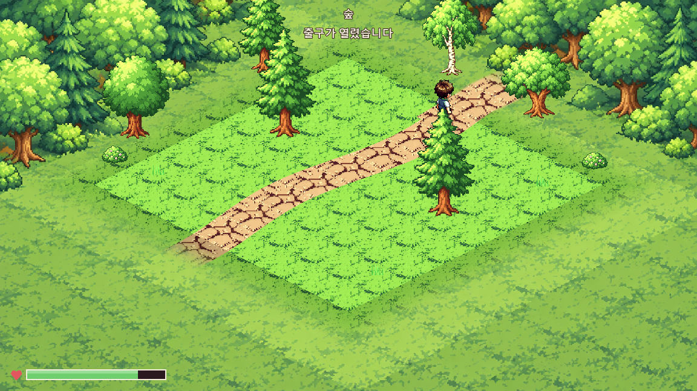
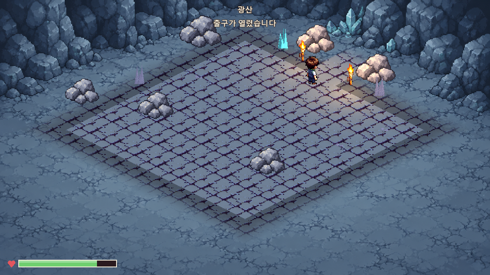
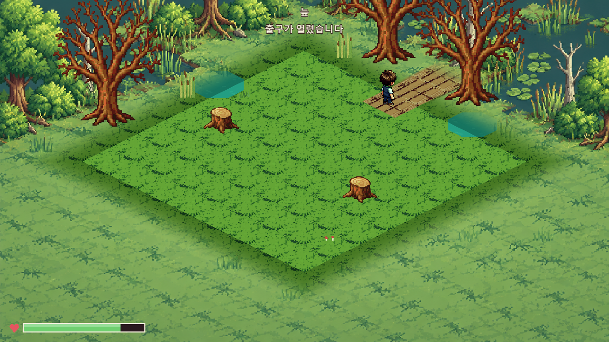

# 포탈 대신 이어지는 길목

2026-10-12 사용자 요청, 브랜치 `main`.

## 적용

원정 방의 돌문·창살 포탈을 활성 화면에서 빼고, 기존 바닥 그림을 지면에 이어 **다음 구역으로 향하는 길**처럼 표시한다.

| 지역 | 길목 |
|---|---|
| 숲·초원 | 기존 흙길이 나무·풀 사이로 계속 이어짐 |
| 광산 | 바위 사이의 돌길, 양옆 횃불 |
| 유적 | 무너진 담·기둥 사이의 돌길, 양옆 횃불 |
| 늪·계곡 | 나무판자 길이 바깥으로 이어짐 |

기존 `dirt`·`paving`·`wood` 64×32 타일과 노멀맵을 재사용했다. 새 포탈 그림이나 가구 이미지는 만들지 않았다. 기존 가장자리 소품의 위치·균일 배율을 조정해 길 양옆을 받치며, 장식 개수 제한은 늘리지 않았다.

길은 실제 `model.exit_position`을 읽어 배치한다. 판정 위치는 기존 `(3.5, 0.5)`이며 길의 안쪽 부분과 일치한다. 바깥으로 향하는 부분은 배경에 부드럽게 섞인다. 머리 위의 `출구` 이름표와 포탈 전용 광원은 제거했다.

전투 중에는 같은 길을 어둡게 표시하고, 가까이 다가가면 남은 몬스터 상태를 제목 아래에 알린다. 실제 몬스터 처치 완료 후 길이 원래 색으로 밝아진다. **다음 방 이동은 기존 E 상호작용 방식**이며, 자동 이동으로 바꾸지는 않았다. 보스는 기존 처치 후 결과 흐름을 유지한다.

## 실제 실행 화면

전투 중 예시: [숲의 안전하지 않은 길](원정_길목_연결/숲_전투중.png). 다른 지역: [유적](원정_길목_연결/유적.png), [초원](원정_길목_연결/초원.png), [계곡](원정_길목_연결/계곡.png).

## 연결과 검증

- 길의 종류·폭·길이·안쪽 연결 길이·색조는 `data/art/expedition_scene_compositions.json`의 `exit_path`에 모았다.
- 렌더링은 `ExpeditionExitPath`와 `expedition_exit_path.gdshader`가 맡는다. 기존 8×8 이동 한계·충돌·드롭·저장 필드는 바꾸지 않았다.
- `exit_open`/`exit_closed` 원본 PNG는 보존하고 매니페스트에서 `legacy_exit_reference`로 명시했다. 현재 게임 방에서는 이 돌문 그림을 선택하지 않는다. 이전 제작 템플릿의 참고 자료로만 남긴다.

Godot 4.7.1, 사용자 저장 파일과 분리한 검증 복사본:

| 검사 | 결과 |
|---|---|
| 6지역 길목 GPU·재료/법선/실제 판정 위치·통행 제한·처치 해제·중복 이동 방지 | 264개, 실패 0 |
| 기존 원정 몬스터·채집·그림 연결 | 1,014개, 실패 0 |
| 실제 키 입력·채집·전리품·출구·철수 | 66개, 실패 0 |
| 작은 창 HUD·HP·피해 숫자 | 102개, 실패 0 |
| 코드·장면 로드 | 896개, 실패 0, SCRIPT ERROR/ERROR 0 |
| 원정 자동 진행 | 16/16 완주, 104노드, 중단 0 |
| 가져오기 2회 | 오류 0 |
| 활성 그림 경로 감사 | 1,531개, 실패 0 |
| 에셋·경제·문서 | 에셋 FAIL 0·기존 WARN 28, 경제 계산 종료 코드 0 |

길목 전용 검사는 격리된 방 모델의 실제 명중/처치 함수와 상호작용을 검증한다. 연속 이동·전투 진행은 별도의 16판 자동 진행 검사가 확인했다. 기존 전체 로드의 Unicode NUL 경고는 남아 있다.

검사 장면: `res://dev/scenes/check_expedition_exit_paths.tscn`. 사용자 실행 폴더에서 `main`을 Pull한 뒤 게임을 다시 시작한다.
