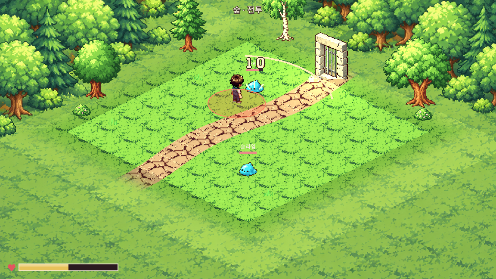
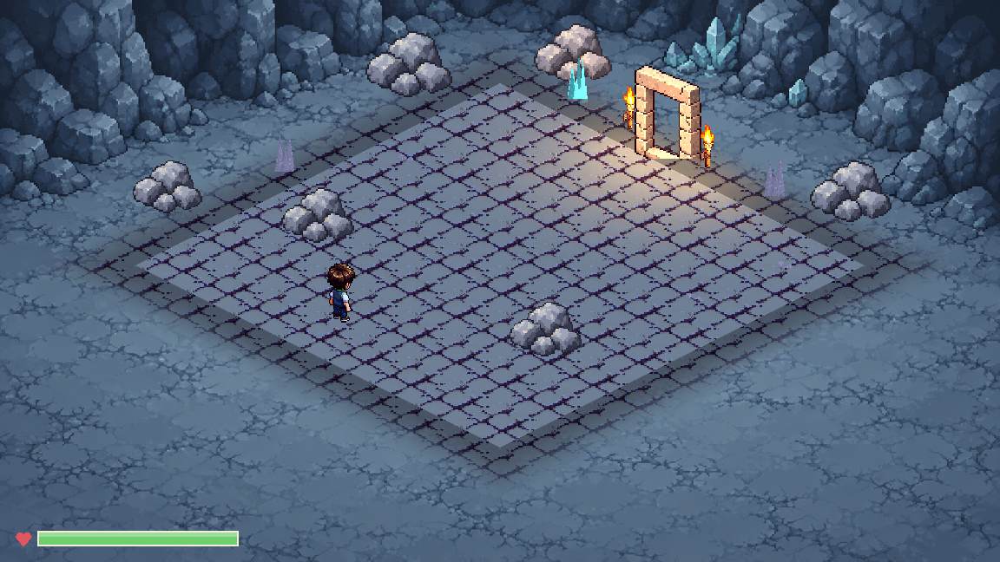
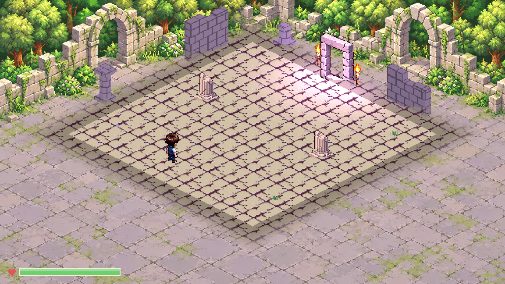

# 원정 배경과 장식 밀도 정리

2026-10-12 사용자 요청. 브랜치 `main`.

후속 사용자 요청으로 이 문서의 돌문 출구는 [자연스러운 길목](원정_길목_연결.md)으로 교체했다. 아래 배경 제작 캡처는 길목 교체 전의 기록이다.

## 방향과 적용

여러 겹의 나무·암벽과 무작위 바닥 장식이 전투·채집 대상과 경쟁하던 화면을 정리했다. 먼 풍경은 지역별 배경 그림 한 장으로 묶고, 가까운 장식은 가장자리의 작은 무리 몇 곳에만 놓는다.

- imagegen으로 숲·광산·늪·유적·초원·계곡 **배경 6장**을 각각 제작했다. 기존 실행 화면을 그림체 참고로 사용했고, 생성된 1672×941 원본 픽셀을 그대로 게임에 복사했다.
- 배경의 중앙은 비워 플레이어·몬스터·출구·채집물의 표시를 방해하지 않게 했다.
- 장식 전용 오브젝트는 지역당 최대 **6~10개**, 그중 방 안 작은 장식은 최대 **2~3개**다. 시작점·출구·적·장애물·채집물 주변은 피해서 배치한다.
- 바닥은 기존 64×32 타일과 노멀맵을 사용한다. 배경과 어울리는 색조를 지역별로 정하고, 8×8 플레이 영역 바깥의 바닥만 배경에 부드럽게 섞는다.
- 원본 비율을 유지해 배경을 화면에 채우며, 좁은 창에서는 양옆을 잘라 표시한다. 화면 해상도를 줄여 도트화하는 처리는 없다.

충돌이 있는 장애물, 플레이어 이동 범위, 적·채집물 위치, 드롭 규칙·해금·저장 필드는 바꾸지 않았다. 배경 자체는 충돌 없는 그림이며, 기존 조명·날씨 효과는 실제 바닥과 인물에 유지한다. 야외 배경에도 기존 계절 색조를 적용한다. 계절마다 별도 배경 원화가 있는 방식은 아니다.

## 실제 표시 수

같은 검사 조건에서 세었다. 아래 숫자는 **원래 충돌 장애물 2개도 포함**한다. 원정의 적·상호작용 대상·출구는 별도다.

| 지역 | 정리 전 | 정리 후 |
|---|---:|---:|
| 숲 | 67 | 11 |
| 광산 | 49 | 12 |
| 늪 | 52 | 9 |
| 유적 | 38 | 7 |
| 초원 | 65 | 9 |
| 계곡 | 49 | 8 |

실제 방의 채집물·적·장애물 배치에 따라 안전 영역과 겹치는 바닥 장식은 생략된다. 두 실행의 무작위 장애물 배치가 달라질 수 있으나 게임 이동·충돌 규칙은 동일하다.

## 실제 실행 화면

숲 정리 전 화면: [정리 전](원정_배경과_장식_정리/숲_정리전.png). 배경 원화 6장 비교: [배경 비교](받은그림/원정_배경/배경_비교.png).

## 데이터와 검증

`data/art/expedition_scene_compositions.json`에 지역별 배경·원본 SHA256, 가까운 장식 좌표·개수 제한·바닥 색조를 모았다. 배경 원본·프롬프트는 `docs/그림_작업/받은그림/원정_배경/`, 게임 그림은 `art/received/expedition/backdrops/`에 있다. `tools/art/install_expedition_backdrops.py` 기본 실행은 원본/게임 해시·비율·개수·출구 안전 영역을 읽기 전용으로 검사한다.

Godot 4.7.1, 사용자 저장 파일과 분리한 검증 복사본:

| 검사 | 결과 |
|---|---|
| 배경 원본·게임 SHA/비율/지역 배치 | 6종 통과 |
| 실제 마을/원정 환경 그림·장식 제한·안전 영역 | 449개, 실패 0 |
| 원정 몬스터·채집·출구 그림 연결 | 1,023개, 실패 0 |
| HUD·HP·피해 숫자 GPU | 1152×648·593×523 각각 102개, 실패 0 |
| 전체 코드·장면 로드 | 893개, 실패 0, SCRIPT ERROR/ERROR 0 |
| 원정 자동 진행 | 16/16 완주, 104노드, 중단 0 |
| 최종 가져오기 2회 | 오류 0 |
| 에셋 규격 | PASS 1883·기존 WARN 28·FAIL 0 |

전체 로드의 기존 Unicode NUL 경고는 남아 있다. 기존 모델 원본을 출력하는 제작 도구는 `use_prepared_art = false`로 이전 템플릿을 사용할 수 있다. 활성 게임 화면은 새 배경·소수의 스프라이트 배치를 사용한다.

확인하려면 사용자 실행 폴더에서 `main`을 Pull하고 실행 중인 게임을 종료한 뒤 다시 시작한다.
