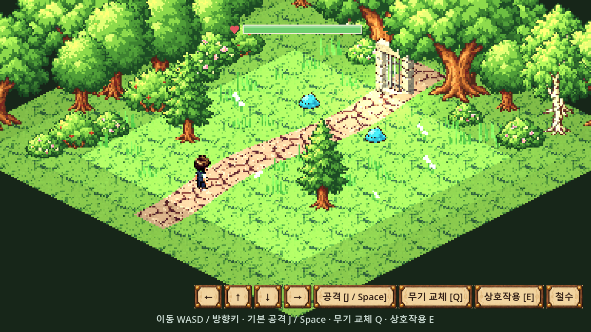
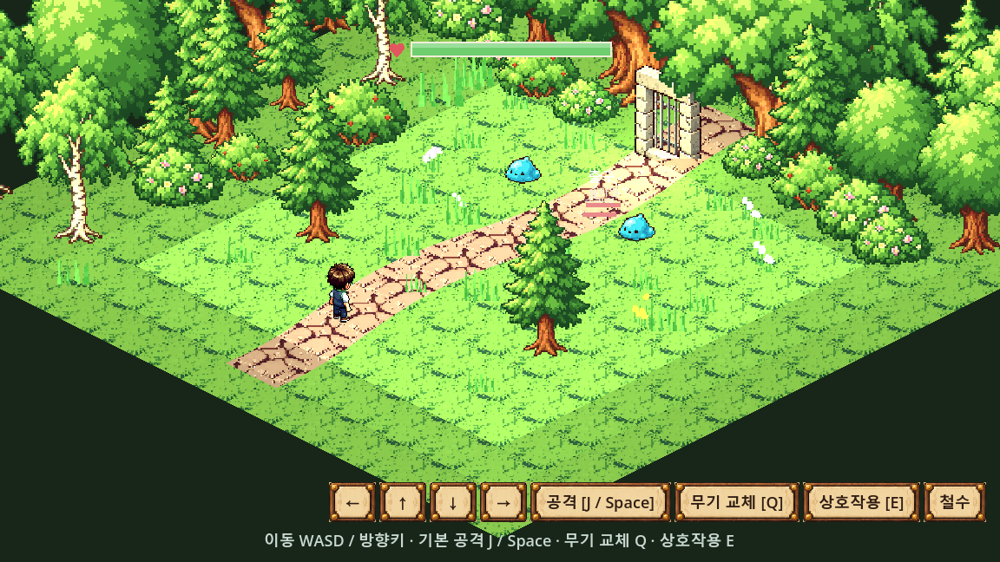
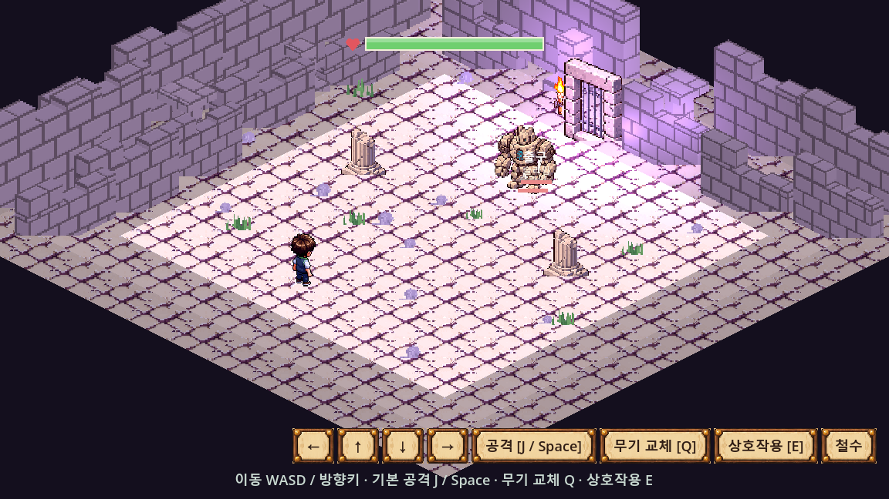

# 원정 화면의 강제 도트화 해제

2026-10-12, 사용자 요청. 작업 브랜치: `main`.

## 원인과 수정

원정 방은 `SubViewportContainer.stretch_shrink = 3`으로 가로·세로 각각 1/3 크기의 화면을 그린 뒤 최근접 방식으로 확대했다. 1152×648 화면에서 실제 무대는 384×216이어서 원본 그림의 작은 눈·잎·바닥 무늬가 큰 사각형으로 뭉쳤다. 플레이어·몬스터 위치도 이 작은 화면의 픽셀 간격에 맞춰 반올림했다.

- 원정 방과 출발 도로의 `stretch_shrink`를 1로 바꿔 표시 영역과 같은 해상도로 그린다.
- 방 안 인물 위치와 출발 도로의 카메라 위치 반올림을 없애 연속적으로 이동한다.
- 체력·상호작용 표시의 투영 좌표는 가로·세로 각각의 표시 배율을 사용한다.

원본 도트 텍스처의 최근접 샘플링, 그림 종횡비, 노멀맵 조명, 등각 카메라·가림과 기존 충돌·진행·보상은 유지한다. 원정 그림을 다시 생성하거나 이미지를 축소하지 않았다. 마을 무대와 개발용 모델 도트화 시험은 수정 대상이 아니다.

## 실제 실행 화면

같은 숲 지역의 수정 전·후 GPU 캡처다. 방의 나무 배치는 실행마다 달라질 수 있다.

### 수정 전

### 수정 후

## 검증

Godot 4.7.1, 사용자 저장 파일과 분리한 실행·검증 복사본을 사용했다.

| 검사 | 결과 |
|---|---|
| 가져오기 2회 | 종료 코드 0, SCRIPT ERROR/ERROR 0 |
| 실제 원정 그림 연결·표시 | 1,023개, 실패 0 |
| 표시 영역 1152×648 및 593×523 | 무대 버퍼가 표시 영역 크기와 일치, 지도 중심 투영 오차 0.1px 미만 |
| 인물·카메라 이동 | 좌표 반올림 없음, 플레이어 0.001칸 이동 보존 |
| 전체 코드·장면 로드 | 887개, 실패 0 |
| 원정 자동 진행 | 16/16 완주, 104노드, 중단 0 |
| 이미지 규격·문서 연결 | 이미지 FAIL 0·기존 WARN 28, 깨진 링크·목록 누락 0 |

전체 로드의 기존 Unicode NUL 경고 4개는 남아 있다. 작은 크기 검사는 무대 크기와 투영 좌표를 검사하며, 전체 책 UI 재배치를 검증하는 검사는 아니다. 렌더링 픽셀 수는 이전의 9배이므로 저사양 기기 성능은 별도 확인이 필요하다.

검사: `res://dev/scenes/check_expedition_sprite_art.tscn`. 사용자 실행 폴더에서 `main`을 Pull한 뒤 실행 중인 게임을 종료하고 다시 시작한다.
