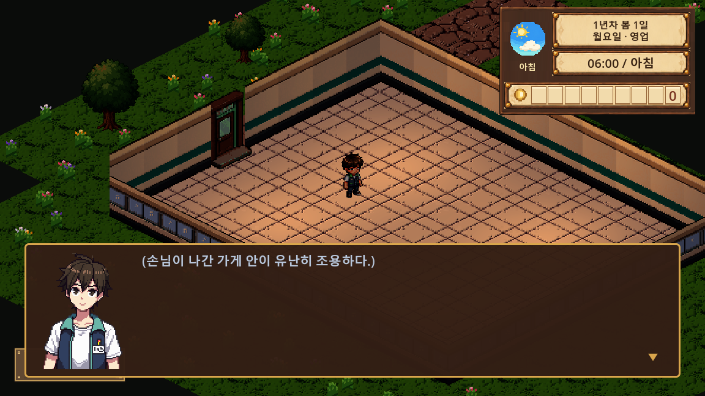

# 목요일 Windows 플레이 테스트 전달 준비

2026-10-12 · 사용자 확정 목표: **2026-10-15(목)까지 다른 사람에게 전달할 Windows 실행 파일**.

## 완료 기준

- Godot가 설치되지 않은 Windows x64 PC에서 ZIP을 압축 해제하고 실행할 수 있다.
- 새 게임 → 첫 결제 → 장비 교환 → 원정 → 재료 판매 → 부탁/도구/물 채집 → 첫 제작/창고 → 다음 날 저장/프로그램 재실행의 흐름이 진행된다.
- 진행이 막히거나 물품·저장 데이터가 없어지는 오류가 없다.
- 대화·결과·제작·관리 화면의 확인/닫기 버튼과 글자가 기본 창 크기에서 읽힌다.
- EXE·PCK·한국어 조작/피드백 안내·엔진 라이선스·빌드 버전과 SHA256을 ZIP으로 전달한다.

## 첫 전달 후보 생성 완료

`Project222-Windows-RC1.zip`(80,308,649바이트)을 생성했다. 소스 커밋은 `5ff989268ccd568aa1b7739def98550949b20786`, 빌드 이름은 `rc1-20261012`다. ZIP 내부의 `BUILD_INFO.json`과 `SHA256SUMS.txt`로 파일 버전을 확인한다.

Git 커밋의 런타임 소스만 새 폴더에 풀고 `.godot` 없이 가져오기 2회→release export→엔진 라이선스→ZIP을 실행했다. 두 번째 가져오기·export·라이선스 로그의 SCRIPT ERROR/ERROR는 0이다. 생성 ZIP을 다시 별도 새 폴더에 풀어 모든 전달 파일의 SHA256을 확인했으며, EXE headless 시작120프레임 종료0·ERROR0을 확인했다. [빌드 정보](검사/첫_후보_빌드.json)는 첫 후보의 기록이고, 이후 문서 커밋과 버전이 다를 수 있다.

ZIP에는 `Project222.exe`, `Project222.pck`, `README_KO.txt`, `GODOT_LICENSES.txt`, `BUILD_INFO.json`, `SHA256SUMS.txt`만 넣었다. 다른 사람에게는 ZIP 전체를 전달한다. **다른 PC의 손 조작 점검 전인 첫 테스트 후보이며 최종 완료 표시는 아니다.**

## RC2 후보 생성 (2026-10-13, 후속 작업 없는 최종 전달용)

- 소스 커밋 `4f14e4e`, 빌드 이름 `rc2-20261013`, `Project222-Windows-RC2.zip`(72,738,507바이트). 클라우드(리눅스)에서 `tools/release/build_windows.sh`로 만들었다(PowerShell 스크립트와 같은 순서: 커밋 소스 → 가져오기 2회 → release 내보내기 → 엔진 라이선스 → ZIP). PowerShell 스크립트는 이 환경에 PowerShell이 없어 실행해 보지 못했다.
- 가져오기 2회차·내보내기에 `SCRIPT ERROR`/`ERROR` 0. ZIP을 풀어 SHA256 4개 일치, 패키지(PCK)를 리눅스 엔진으로 헤드리스 240프레임 실행해 오류 0(시작 화면까지). 새 데이터(계산·게이트·집터·가격 CSV)가 PCK에 들어 있음을 확인.
- **Windows에서 실제로 실행해 보지는 못했다**(클라우드에 Windows가 없다). 다른 PC 실행·손 조작 확인은 여전히 필요하다.
- 알려진 한계는 `플레이테스트_안내.txt`의 "알려진 한계"에 적었다.

## 마감 전 우선순위

| 우선순위 | 항목 | 현재 |
|---|---|---|
| P0 | Windows 내보내기/원본 CSV/JSON 포함 | 프리셋·원본 CSV 내보내기 플러그인 추가. CSV 53개 포함 확인 |
| P0 | 배포에서만 나타나는 파서 오류 | 주민 친밀도 기본 PackedArray의 상수 리소스 추론 오류 발견, 실행 시 `get`으로 읽게 수정 |
| P0 | 개발 편집기·계절/날씨 강제 키 차단 | F6/F7/F8/F10/F12와 C 디버그 생성은 editor 빌드에서만 허용. F5 실제 저장은 유지 |
| P0 | 새 게임부터 저장/재개까지 연속 진행 | native release QA, seed53241: 114개 실패0·원정3회·다음 날 저장/재개 통과 |
| P0 | 소스·에디터 캐시 없는 새 빌드 | 커밋5ff98926의 새 staging에서 빌드·ZIP·압축 해제/해시/시작 검사 통과 |
| P1 | 다른 PC에서 실제 실행과 손 조작 | 사용자/테스터의 압축 해제·실행·첫 거래·원정·저장 재개 확인 대기 |
| P1 | 화면/DPI·소리·영업 체감 | 기본 화면의 native GPU 확인, 작은 창·다른 PC·장시간 영업은 추가 확인 |
| P1 | 계절/날씨·냉장/냉동·행사/부탁 동시 진행 | 기존 개별 검사 이후의 최신 전체 흐름 확인 필요 |
| 후속 | 신규 대형 콘텐츠·전원 좌식·새 애니메이션·후반 장기 밸런스 | 이번 전달 후보에 새로 추가하지 않는 것을 권장 |

## 일정

| 날짜 | 마무리 목표 |
|---|---|
| 월 10/12 | 첫 Windows 후보·배포 누락/진행 차단 수정·전달 안내와 버전 고정 방법 |
| 화 10/13 | 후보로 핵심 순환과 저장/재개·미해금 접근·재료 부족 상황 확인, 막히는 문제 우선 수정 |
| 수 10/14 | 다른 PC 피드백·UI/그림·소리 확인, 계절/날씨와 기존 이벤트 회귀, 최종 후보 생성 |
| 목 10/15 | 확인한 차단 오류만 수정·새 ZIP 검증·최종 파일과 알려진 제한 전달 |

마감 범위는 **현재 구현된 게임을 전달할 수 있게 안정화**하는 것이다. 완료 기준을 충족하지 않은 항목은 완료로 표시하지 않는다. 112일 전체의 모든 난수/모든 후반 조합을 자동 검사 한 번으로 보장하지 않는다.

## 실제 발견한 배포 오류

에디터에서 읽히던 `items.csv`·원정 상점·장비·직원·시작 가구 CSV가 Translation으로 가져오기되어 실제 PCK에는 원본이 빠졌다. `include_filter=*.csv`만으로 해결되지 않았다. `addons/runtime_csv_export`가 원본 CSV를 넣고 번역용 기본 대체 출력은 건너뛴다. CSV 내용과 기존 `.import`/번역 산출물은 수정·삭제하지 않았다.

내보내기 종료 코드가 0이어도 `SCRIPT ERROR`가 나오는 경우가 있었다. 빌드 도구는 종료 코드와 로그를 함께 검사하고 해당 오류가 있으면 ZIP 제작을 중단한다. 실제 템플릿은 실행 시 `--script`/`--scene` 옵션을 제공하지 않으므로, 시작 화면 검사는 실제 전달 EXE로 하고 내부 상호작용 검사는 별도 QA PCK의 main scene으로 실행했다. QA 빌드/원본 리소스 ZIP/검사 소스는 전달 ZIP에서 제외한다.

완전히 빈 캐시의 첫 가져오기는 Theme가 아직 생성 전 `.ctex`를 참조해 오류를 기록할 수 있다. 첫 회는 종료0으로 캐시를 생성하고, **두 번째 가져오기·export·라이선스 단계는 종료0과 SCRIPT ERROR/ERROR0을 모두 요구**한다. 첫 회 로그도 보존하며 실제 오류가 두 번째에 남으면 빌드를 중단한다.

## 빌드 재현

`export_presets.cfg`의 `Windows Desktop`은 x86_64 release, EXE와 PCK 분리, 개발 문서/소품 원화/검사/플러그인 제외다. `*.csv,*.json`과 원본 CSV 플러그인을 함께 사용한다.

커밋 후 PowerShell에서 다음처럼 실행한다. 같은 이름의 빌드를 덮어쓰지 않으며, `.godot`을 복사하지 않고 커밋의 런타임 소스만 새 폴더에서 가져온다. 템플릿이 표준 위치에 설치돼 있으면 `-TemplateDirectory`는 생략할 수 있다.

```powershell
./tools/release/build_windows.ps1 -GodotExe '<Godot 콘솔 exe 절대 경로>' -OutputDirectory '<새 출력 폴더>' -TemplateDirectory '<같은 버전 Windows 템플릿 폴더>' -BuildLabel 'rc1'
```

실행 자료는 [플레이 테스트 안내](플레이테스트_안내.txt). 배포 과정은 [Godot Windows 내보내기](https://docs.godotengine.org/en/stable/tutorials/export/exporting_for_windows.html), 원본 추가는 [EditorExportPlugin](https://docs.godotengine.org/en/stable/classes/class_editorexportplugin.html)을 따른다.

## 현재 검사 근거

- Godot 공식 4.7.1 템플릿 전체 파일은 공식 SHA512 검증을 통과했다. Windows x64 템플릿만 작업용 환경에 추출했다.
- 생산용 리소스 ZIP: 5566개 파일, 원본 CSV 53개, `dev/docs/tools/addons` 파일 0개.
- native release QA GPU 검사: 978개 실패 0, CSV 53·JSON 20·현재 그림 경로 831. CSV 바이트가 생산용 ZIP과 동일하며, 실제 새 게임·줌1.15·친밀도 이름·개발키 차단 확인.
- native release QA 연속 진행: seed53241, 114개 실패0·원정3회. 시작 수입0에서 첫 결제/원정 재료 판매/주민 부탁/물병 구매/물 채집/첫 제작/창고/다음 날 슬롯 저장·시작 화면 재개까지 통과했다. 가게 이동·타이머·UI는 기존 검사 도구가 제어하므로 전체 손 조작 검증으로 해석하지 않는다.
- 첫 가게 대화 화면에서 120프레임의 중앙/95% 프레임 시간은 약 13.33ms였다. 혼잡 매장·다른 PC의 성능 보장이나 장시간 측정은 아니다.
- 실제 전달 EXE를 소스 없는 폴더·새 APPDATA에서 headless 120프레임 실행: 종료0, SCRIPT ERROR/ERROR0.
- 에셋 활성 연결 감사1777 실패0. `validate_story.py`는 기본 4장면만 검사해 오류/주의0이었으며, 전체 대사556행 검사 결과로 해석하지 않는다.
- 기존 Door 충돌/Unicode NUL 경고는 배포 차단 오류와 구분해 기록한다.
- 최신 코드·씬 전체909개 로드 실패0, SCRIPT ERROR/ERROR0.

검사 원본은 `검사/첫_릴리스_검사.json`과 `검사/연속_진행.json`이다. 아래는 실제 release QA 빌드의 첫 가게 대화 화면이다.


